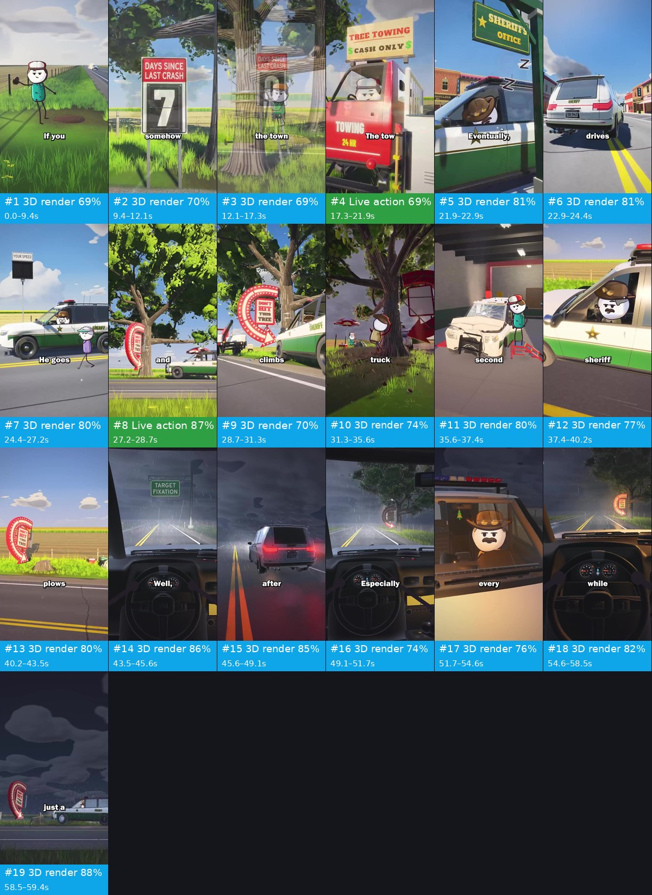
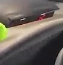
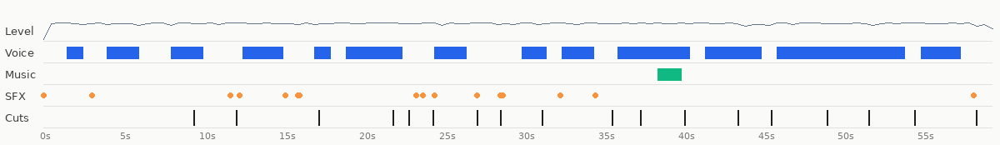

# How this video was made: The_Instinct_That_Makes_You_Crash.mp4

**In one line**: hook: the strange act on screen in the first seconds → … → closing line lands back on the title claim
**How it was made**: Mixed production: 3D render 90% + live action 10%

- 0:59 · vertical 9:16 · 19 shots, 3.1s each on average
- Confidence 76%, based on: tool measurements + AI assistant reviewed 19 shots
- ⚠️ 3 points are uncertain, see “Open questions”

<!--mix-->



# Part one · Breakdown: how this video is built

## What makes it work

- **Opening 0.0–12.1s**: hook: the strange act on screen in the first seconds

## At a glance: picture, packaging, sound

Any short video splits into three layers: the picture, what is laid on top of it (subtitles, styled text, stickers), and the sound. Remake it one layer at a time.

| Layer | In this video | How to make it | Detail |
|---|---|---|---|
| **Picture** (base) | 3D render 17 shots, live action 2 shots | filmed in 1 scene; AI in 6 generations | “Remake it yourself” |
| **Packaging** (on top) | animated sticker / GIF, graphic | add in the editor: subtitles, styled text and stickers by the timeline | “Packaging layer” |
| **Sound** | voice（TTS voice-over）, 16 sound effects | voice: TTS voice-over; effects: add from a library at the listed times | “Sound” |

## Content and structure

- The narrative line below comes from reading each shot; the lines were not transcribed separately, subtitle text is under “Packaging layer”

**Narrative line**

Keep this line in a remake: same order, same job at each step, with the point refilled from your own cases, numbers and material, so it is more than a change of subject.

| Time | Shots | Job | What it says |
|---|---|---|---|
| 0.0–12.1s | #1, #2 | grab attention | hook: the strange act on screen in the first seconds |
| 12.1–35.6s | #3–#10 | — | establish the place and the machine while the hero acts |
| 35.6–43.5s | #11–#13 | — | the diegetic sign/alarm flips the mood |
| 43.5–54.6s | #14–#17 | — | the literal payoff of the claim, POV thrill beat |
| 54.6–59.4s | #18, #19 | — | closing line lands back on the title claim |

## Shot list

| # | Frame | Time | What it says | Picture | Camera | Made with |
|---|---|---|---|---|---|---|
| 1 |  | 0:00.0 · 9.4s | grab attention: hook: the strange act on screen in the first… | The_Instinct_That_Makes_You_Crash: 3D toon set with flat 2D … | smooth move | 3D render |
| 2 |  | 0:09.4 · 2.7s | grab attention: hook: the strange act on screen in the first… | The_Instinct_That_Makes_You_Crash: 3D toon set with flat 2D … | smooth move | 3D render |
| 3 |  | 0:12.1 · 5.2s | establish the place and the machine while the hero acts | The_Instinct_That_Makes_You_Crash: 3D toon set with flat 2D … | smooth move | 3D render |
| 4 |  | 0:17.3 · 4.7s | establish the place and the machine while the hero acts | The_Instinct_That_Makes_You_Crash: 3D toon set with flat 2D … | smooth move | live action |
| 5 |  | 0:21.9 · 1.0s | establish the place and the machine while the hero acts | The_Instinct_That_Makes_You_Crash: 3D toon set with flat 2D … | smooth move | 3D render |
| 6 |  | 0:22.9 · 1.5s | establish the place and the machine while the hero acts | The_Instinct_That_Makes_You_Crash: 3D toon set with flat 2D … | smooth move | 3D render |
| 7 |  | 0:24.4 · 2.8s | establish the place and the machine while the hero acts | The_Instinct_That_Makes_You_Crash: 3D toon set with flat 2D … | smooth move | 3D render |
| 8 |  | 0:27.2 · 1.5s | establish the place and the machine while the hero acts | The_Instinct_That_Makes_You_Crash: 3D toon set with flat 2D … | smooth move | live action |
| 9 |  | 0:28.7 · 2.6s | establish the place and the machine while the hero acts | The_Instinct_That_Makes_You_Crash: 3D toon set with flat 2D … | smooth move | 3D render |
| 10 |  | 0:31.3 · 4.4s | establish the place and the machine while the hero acts | The_Instinct_That_Makes_You_Crash: 3D toon set with flat 2D … | smooth move | 3D render |
| 11 |  | 0:35.6 · 1.8s | the diegetic sign/alarm flips the mood | The_Instinct_That_Makes_You_Crash: 3D toon set with flat 2D … | smooth move | 3D render |
| 12 |  | 0:37.4 · 2.8s | the diegetic sign/alarm flips the mood | The_Instinct_That_Makes_You_Crash: 3D toon set with flat 2D … | smooth move | 3D render |
| 13 |  | 0:40.2 · 3.3s | the diegetic sign/alarm flips the mood | The_Instinct_That_Makes_You_Crash: 3D toon set with flat 2D … | smooth move | 3D render |
| 14 |  | 0:43.5 · 2.1s | the literal payoff of the claim, POV thrill beat | The_Instinct_That_Makes_You_Crash: 3D toon set with flat 2D … | smooth move | 3D render |
| 15 |  | 0:45.6 · 3.5s | the literal payoff of the claim, POV thrill beat | The_Instinct_That_Makes_You_Crash: 3D toon set with flat 2D … | smooth move | 3D render |
| 16 |  | 0:49.1 · 2.6s | the literal payoff of the claim, POV thrill beat | The_Instinct_That_Makes_You_Crash: 3D toon set with flat 2D … | smooth move | 3D render |
| 17 |  | 0:51.7 · 2.9s | the literal payoff of the claim, POV thrill beat | The_Instinct_That_Makes_You_Crash: 3D toon set with flat 2D … | smooth move | 3D render |
| 18 |  | 0:54.6 · 3.9s | closing line lands back on the title claim | The_Instinct_That_Makes_You_Crash: 3D toon set with flat 2D … | smooth move | 3D render |
| 19 |  | 0:58.5 · 1.0s | closing line lands back on the title claim | The_Instinct_That_Makes_You_Crash: 3D toon set with flat 2D … | smooth move | 3D render |

## Cast, scenes and props

- No cast extracted this time (needs AI image reading); shots where the face detector saw a face (person or character): #5, #9, #17

## Camera and lighting

- Framing: shot size medium close-up 100%; camera angle eye level; subject is the in-focus region (no face; shot size is an estimate)
- Camera: moving camera (gimbal / handheld pan) 100%; typical move pan / track
- Lighting: soft frontal light (flat light). Key light frontal (from the camera side; both sides of the subject about equally bright), at subject height; lighting ratio about 1.2:1 (0.3 stops); hard light (sharp shadow edge); colour temperature warm (about 3000–4000K); background clearly blurred (shallow depth of field / portrait mode)
- Grade: natural (close to the original colours); normal saturation, normal contrast, lifted blacks (greyish shadows), overall neutral

<details class="ref"><summary>Per-item measurements and image readings (12)</summary>

| Aspect | Item | Verdict | Sources |
|---|---|---|---|
| Framing | shot size | medium close-up | measured |
| Framing | camera angle | eye level | agent review |
| Framing | composition | subject big, faces above the caption band | agent review |
| Camera | camera support | virtual camera, hand-held feel via drift | measured: moving camera (gimbal / handheld pan); agent review |
| Camera | lens | 24-33 mm equivalent | agent review |
| Camera | speed | rest 0.6-1.8 px/f, travels 10-27 px/f | agent review |
| Lighting | location | set interior/exterior per place | agent review |
| Lighting | key light | diegetic practical (lamp/torch/window) | agent review |
| Lighting | soft / hard | hard light (sharp shadow edge) | measured; agent review: soft toon steps |
| Lighting | colour temperature | warm (about 3000–4000K) | measured; agent review: place-owned warm/cool per DNA |
| Lighting | lighting set-up | hemisphere + directional key + practical point lights | agent review |
| Grade | colour grade | natural (close to the original colours) | measured; agent review: dark-mid luminance, sat 0.27-0.51, place-owned warmth |

- Note: lighting ratio, soft / hard, colour temperature and shot size are measured on the subject's pixels (the face when there is one, otherwise the in-focus region, which is an estimate); platform transcodes crush the shadows, so hardness and fill read conservative; camera angle, light source, catchlight and rim light follow the image readers. Where measurement and readers disagree, both are listed.

</details>

## Packaging layer (subtitles / styled text / stickers / sound-effect hits)

- Stickers / GIFs: animated sticker / GIF ×1
- Possible SFX hits (unconfirmed signal candidates) on: cut ×5, sticker in ×1
- 1 persistent layers (unchanged across cuts: lay each on once for its span, not per shot): animated sticker / GIF 24.5–28.6s

**Stickers / GIFs / picture-in-picture**

| Time | Kind | Position | Motion | Confidence | Crop |
|---|---|---|---|---|---|
| 24.50–28.60s | animated sticker / GIF | x15% y37% w15% h9% | animated | medium (unchanged across a cut) |  |

- Remake: import `packaging/subtitles.srt` into your editor and put in your own words; the styled version is `packaging/overlays.ass`; find matching stickers and GIFs in an asset library

## Sound

**Voice**

- female-leaning
- Source: TTS voice-over
- Remake: TTS voice-over: CapCut text-to-speech or another TTS tool, with a similar voice and pace

**Sound effects** (16)

<details class="ref"><summary>all 16 sound effects</summary>

| Time | Listen | Type | Description | On screen |
|---|---|---|---|---|
| 0.05s | [listen](sfx/sfx_01.wav) | whoosh | — | — |
| 3.06s | [listen](sfx/sfx_02.wav) | whoosh | — | — |
| 11.70s | [listen](sfx/sfx_03.wav) | whoosh | — | — |
| 12.29s | [listen](sfx/sfx_04.wav) | whoosh | — | cut |
| 15.19s | [listen](sfx/sfx_05.wav) | ding | — | — |
| 15.97s | [listen](sfx/sfx_06.wav) | whoosh | — | — |
| 16.08s | [listen](sfx/sfx_07.wav) | whoosh | — | — |
| 23.36s | [listen](sfx/sfx_08.wav) | whoosh | — | — |
| 23.80s | [listen](sfx/sfx_09.wav) | ding | — | — |
| 24.50s | [listen](sfx/sfx_10.wav) | ding | animated sticker / GIF appears | animated sticker / GIF appears |
| 27.18s | [listen](sfx/sfx_11.wav) | ding | — | cut |
| 28.66s | [listen](sfx/sfx_12.wav) | ding | — | cut |
| 28.78s | [listen](sfx/sfx_13.wav) | whoosh | — | cut |
| 32.43s | [listen](sfx/sfx_14.wav) | ding | — | — |
| 34.59s | [listen](sfx/sfx_15.wav) | whoosh | — | — |
| 58.30s | [listen](sfx/sfx_16.wav) | whoosh | — | cut |

</details>

- Remake: take a similar effect from your editor's library and place it at that time

<details class="ref"><summary>Sound measurements and evidence</summary>



- Loudness -17.1 dBFS, peak -2.2 dBFS
- sound runs across cuts, laid in post as one bed (background changes 5.3dB at cuts vs 4.5dB within shots)
- Voice on 60% of the duration, pitch about 210.0Hz
- Voice source: TTS voice-over (TTS voice-over 64%, human recording 27%, native dialogue from the AI video model 9%)
  - Voice and background sound run across cuts: the voice-over was laid on separately in post (TTS or a human voice-over)
- Effects source: added in post from an SFX library / editor (added in post from an SFX library / editor 57%, generated with the picture by the video model (native audio) 29%, location sound 14%)
  - Cartoon SFX in 3D / animated videos are also often procedurally synthesised or added from a library (e.g. the capsule-cinema plush recipe synthesises them)

</details>

## Open questions

- Shot #4 (17.3–21.9s): Tools say live action, the image review says 3D render; on the AI / live-action axis the fusion follows the tools (eval-calibrated): check the frames to see whether the review's evidence is really visible
- Shot #8 (27.2–28.7s): Tools say live action, the image review says 3D render; on the AI / live-action axis the fusion follows the tools (eval-calibrated): check the frames to see whether the review's evidence is really visible
- No AI listened to the soundtrack (the review covered the picture only): real voice versus TTS is inferred from the waveform; the effects were picked off the mix where the sound jumps, so plosives and drum hits can be counted too. Play the stems and each effect under “Sound” to check

# Part two · Remake plan

Planned for **MiniMax H3 / H3 Max**: ≤15 s per call, several shots per call, no reference video, first / last frame, native sound. Name another model and the split, lengths and prompts are redone for it.

## Remake it yourself: do it in this order

Copy the method and the rhythm, not the pictures: keep what each part does and fill it with your own content and material.

This is a 3D / animation. Do the steps in this order; the detail for each is in the matching subsection below.

1. **Write the content**: write yours in the same 5 steps as the original (narrative line under “Content and structure”)
2. **Collect material**: the real material in the picture (live footage) needs the original files, listed under “What to prepare”
3. **Generate**: 6 calls (53 s), several shots each. Each shot gets one source frame for composition (subtitles erased, in `remake/refs/`), the swapped-in people, animals and products get reference images, and the prompt lists the shots in order
4. **Adapt the prompts to your model**: the prompts in this report are generic, and every model reads them differently (how shots are split, how references are addressed, how dialogue is written). Before generating, rewrite them following the official prompt guide of the model you actually use, or have the agent refine them with that model's prompting skill; notes for MiniMax H3 / H3 Max at the top of “AI generation”
5. **Live shots**: 2 shots to film yourself; camera and light under “Shoot” below
6. **Voice**: the original is TTS voice-over; record it yourself or use TTS; delivery per “Acting and emotion”
7. **Edit**: follow the order and lengths in the shot list; the original has 19 shots at 3.1s each; 2 transitions under “Edit”
8. **Subtitles and styled text**: timing and style under “Packaging layer”
9. **Sound effects**: 16; place similar ones from a library at the times under “Sound”
10. **Put it together and compare**: hand the shots you made to the agent; it places them on the original timeline, keeps the original where yours are missing, and renders a side-by-side comparison with the original

### Shoot

Shoot every shot of one scene before moving to the next; within a scene, shoot the wider sizes first and the close-ups last so the lighting is set only once. Leave about 1s of handle at both ends of every take.

**S1**: shots #4, #8 (6.17s on screen); The_Instinct_That_Makes_You_Crash: 3D toon set with flat 2D character cards, word caption synced to the Bangla narration; place-lit (warm torch/gold or cool night) per the channel DNA.
- Lighting: hemisphere + directional key + practical point lights
- Setup medium close-up · moving camera (gimbal / handheld pan) · pan / track/push-in: shots #4, #8, 6.17s on screen, shoot about 10.2s

Gear (inferred from the measured light):
- one large soft light straight above the desk / behind the camera (or two, symmetrical at 45°)
- white desk or white cards to bounce; shadows go lighter

### AI generation

**6 generations, 53 s in total**

> ⚠️ G1、G2、G3、G4、G5、G6: the prompts are still generic drafts. Rewrite them in MiniMax H3 / H3 Max's official format (or have the agent write them with that model's prompting skill) into `remake/prompts.json`, numbering images in the unit's reference order; `rea-video plan` then checks the format.

| Part | Shots | Time | Length | Prepare |
|---|---|---|---|---|
| G1 | #1, #2 | 0.0–12.1s | 12.1s | reference images |
| G2 | #3 | 12.1–17.3s | 5.2s | reference images |
| G3 | #5–#7 | 21.9–27.2s | 5.2s | reference images |
| G4 | #9–#11 | 28.7–37.4s | 8.7s | reference images |
| G5 | #12–#15 | 37.4–49.1s | 11.7s | reference images |
| G6 | #16–#19 | 49.1–59.4s | 10.3s | reference images |

<details class="ref"><summary>Why it is split this way</summary>

- Grouping: consecutive shots share a call where they fit, ≤15s per call, ≤4 shots; a long stretch is cut at a scene change first
- Inputs: the model takes no reference video: one source frame per shot (subtitles erased) fixes composition, swapped-in things get their own images
- Audio: the model can generate action sound effects and ambience along with the picture; voice-over is better done as separate TTS and mixed in, so copy and timing stay editable
- Packaging: the sticker on the generated shots is post-production packaging: keep it out of the prompts (erased from source references) and lay it back on from the packaging timeline after generation

</details>

<details><summary>G1 · shots #1, #2 · 12.1s</summary>

- reference images: source frames of shots #1、#2 (subtitles erased)
- Acting #1: brow-driven acting o · dot eyes + thick black brows (voice first, then drive, see “Acting and emotion”)
- Acting #2 (key): brow-driven acting o · dot eyes + thick black brows (voice first, then drive, see “Acting and emotion”)

Draft prompt (generic; rewrite it in MiniMax H3 / H3 Max's format into remake/prompts.json before generating):

```text
Generate the shots below in order in one go, hard cuts between them; each shot takes composition, size and camera from its source frame image. Vertical 9:16; soft frontal light (flat light), soft light (wide lit-to-shadow ramp), warm (about 3000–4000K), background clearly blurred (shallow depth of field / portrait mode). No subtitles, captions or watermarks in the picture.
Shot 1 (from 0.0s): The_Instinct_That_Makes_You_Crash: 3D toon set with flat 2D character cards, word caption synced to the Bangla narration; place-lit (warm torch/gold or cool night) per the channel DNA.Acting: dot eyes + thick black brows (composition: @图片1)
Shot 2 (from 9.4s): The_Instinct_That_Makes_You_Crash: 3D toon set with flat 2D character cards, word caption synced to the Bangla narration; place-lit (warm torch/gold or cool night) per the channel DNA.Acting: dot eyes + thick black brows (composition: @图片2)
```

</details>

<details><summary>G2 · shots #3 · 5.2s</summary>

- reference images: source frames of shots #3 (subtitles erased)
- Acting #3 (key): brow-driven acting o · dot eyes + thick black brows (voice first, then drive, see “Acting and emotion”)

Draft prompt (generic; rewrite it in MiniMax H3 / H3 Max's format into remake/prompts.json before generating):

```text
Generate the shots below in order in one go, hard cuts between them; each shot takes composition, size and camera from its source frame image. Vertical 9:16; soft frontal light (flat light), soft light (wide lit-to-shadow ramp), warm (about 3000–4000K), background clearly blurred (shallow depth of field / portrait mode). No subtitles, captions or watermarks in the picture.
The_Instinct_That_Makes_You_Crash: 3D toon set with flat 2D character cards, word caption synced to the Bangla narration; place-lit (warm torch/gold or cool night) per the channel DNA.Acting: dot eyes + thick black brows (composition: @图片1)
```

</details>

<details><summary>G3 · shots #5–#7 · 5.2s</summary>

- reference images: source frames of shots #5、#6、#7 (subtitles erased)
- Acting #5 (key): brow-driven acting o · dot eyes + thick black brows (voice first, then drive, see “Acting and emotion”)
- Acting #6 (key): brow-driven acting o · dot eyes + thick black brows (voice first, then drive, see “Acting and emotion”)
- Acting #7 (key): brow-driven acting o · dot eyes + thick black brows (voice first, then drive, see “Acting and emotion”)

Draft prompt (generic; rewrite it in MiniMax H3 / H3 Max's format into remake/prompts.json before generating):

```text
Generate the shots below in order in one go, hard cuts between them; each shot takes composition, size and camera from its source frame image. Vertical 9:16; soft frontal light (flat light), soft light (wide lit-to-shadow ramp), warm (about 3000–4000K), background clearly blurred (shallow depth of field / portrait mode). No subtitles, captions or watermarks in the picture.
Shot 1 (from 0.0s): The_Instinct_That_Makes_You_Crash: 3D toon set with flat 2D character cards, word caption synced to the Bangla narration; place-lit (warm torch/gold or cool night) per the channel DNA.Acting: dot eyes + thick black brows (composition: @图片1)
Shot 2 (from 1.0s): The_Instinct_That_Makes_You_Crash: 3D toon set with flat 2D character cards, word caption synced to the Bangla narration; place-lit (warm torch/gold or cool night) per the channel DNA.Acting: dot eyes + thick black brows (composition: @图片2)
Shot 3 (from 2.5s): The_Instinct_That_Makes_You_Crash: 3D toon set with flat 2D character cards, word caption synced to the Bangla narration; place-lit (warm torch/gold or cool night) per the channel DNA.Acting: dot eyes + thick black brows (composition: @图片3)
```

</details>

<details><summary>G4 · shots #9–#11 · 8.7s</summary>

- reference images: source frames of shots #9、#10、#11 (subtitles erased)
- Acting #9 (key): brow-driven acting o · dot eyes + thick black brows (voice first, then drive, see “Acting and emotion”)
- Acting #10 (key): brow-driven acting o · dot eyes + thick black brows (voice first, then drive, see “Acting and emotion”)
- Acting #11 (key): brow-driven acting o · dot eyes + thick black brows (voice first, then drive, see “Acting and emotion”)

Draft prompt (generic; rewrite it in MiniMax H3 / H3 Max's format into remake/prompts.json before generating):

```text
Generate the shots below in order in one go, hard cuts between them; each shot takes composition, size and camera from its source frame image. Vertical 9:16; soft frontal light (flat light), soft light (wide lit-to-shadow ramp), warm (about 3000–4000K), background clearly blurred (shallow depth of field / portrait mode). No subtitles, captions or watermarks in the picture.
Shot 1 (from 0.0s): The_Instinct_That_Makes_You_Crash: 3D toon set with flat 2D character cards, word caption synced to the Bangla narration; place-lit (warm torch/gold or cool night) per the channel DNA.Acting: dot eyes + thick black brows (composition: @图片1)
Shot 2 (from 2.6s): The_Instinct_That_Makes_You_Crash: 3D toon set with flat 2D character cards, word caption synced to the Bangla narration; place-lit (warm torch/gold or cool night) per the channel DNA.Acting: dot eyes + thick black brows (composition: @图片2)
Shot 3 (from 7.0s): The_Instinct_That_Makes_You_Crash: 3D toon set with flat 2D character cards, word caption synced to the Bangla narration; place-lit (warm torch/gold or cool night) per the channel DNA.Acting: dot eyes + thick black brows (composition: @图片3)
```

</details>

<details><summary>G5 · shots #12–#15 · 11.7s</summary>

- reference images: source frames of shots #12、#13、#14、#15 (subtitles erased)
- Acting #12 (key): brow-driven acting o · dot eyes + thick black brows (voice first, then drive, see “Acting and emotion”)
- Acting #13 (key): brow-driven acting o · dot eyes + thick black brows (voice first, then drive, see “Acting and emotion”)
- Acting #14 (key): brow-driven acting o · dot eyes + thick black brows (voice first, then drive, see “Acting and emotion”)
- Acting #15 (key): brow-driven acting o · dot eyes + thick black brows (voice first, then drive, see “Acting and emotion”)

Draft prompt (generic; rewrite it in MiniMax H3 / H3 Max's format into remake/prompts.json before generating):

```text
Generate the shots below in order in one go, hard cuts between them; each shot takes composition, size and camera from its source frame image. Vertical 9:16; soft frontal light (flat light), soft light (wide lit-to-shadow ramp), warm (about 3000–4000K), background clearly blurred (shallow depth of field / portrait mode). No subtitles, captions or watermarks in the picture.
Shot 1 (from 0.0s): The_Instinct_That_Makes_You_Crash: 3D toon set with flat 2D character cards, word caption synced to the Bangla narration; place-lit (warm torch/gold or cool night) per the channel DNA.Acting: dot eyes + thick black brows (composition: @图片1)
Shot 2 (from 2.8s): The_Instinct_That_Makes_You_Crash: 3D toon set with flat 2D character cards, word caption synced to the Bangla narration; place-lit (warm torch/gold or cool night) per the channel DNA.Acting: dot eyes + thick black brows (composition: @图片2)
Shot 3 (from 6.1s): The_Instinct_That_Makes_You_Crash: 3D toon set with flat 2D character cards, word caption synced to the Bangla narration; place-lit (warm torch/gold or cool night) per the channel DNA.Acting: dot eyes + thick black brows (composition: @图片3)
Shot 4 (from 8.2s): The_Instinct_That_Makes_You_Crash: 3D toon set with flat 2D character cards, word caption synced to the Bangla narration; place-lit (warm torch/gold or cool night) per the channel DNA.Acting: dot eyes + thick black brows (composition: @图片4)
```

</details>

<details><summary>G6 · shots #16–#19 · 10.3s</summary>

- reference images: source frames of shots #16、#17、#18、#19 (subtitles erased)
- Acting #16 (key): brow-driven acting o · dot eyes + thick black brows (voice first, then drive, see “Acting and emotion”)
- Acting #17 (key): brow-driven acting o · dot eyes + thick black brows (voice first, then drive, see “Acting and emotion”)
- Acting #18 (key): brow-driven acting o · dot eyes + thick black brows (voice first, then drive, see “Acting and emotion”)
- Acting #19 (key): brow-driven acting o · dot eyes + thick black brows (voice first, then drive, see “Acting and emotion”)

Draft prompt (generic; rewrite it in MiniMax H3 / H3 Max's format into remake/prompts.json before generating):

```text
Generate the shots below in order in one go, hard cuts between them; each shot takes composition, size and camera from its source frame image. Vertical 9:16; soft frontal light (flat light), soft light (wide lit-to-shadow ramp), warm (about 3000–4000K), background clearly blurred (shallow depth of field / portrait mode). No subtitles, captions or watermarks in the picture.
Shot 1 (from 0.0s): The_Instinct_That_Makes_You_Crash: 3D toon set with flat 2D character cards, word caption synced to the Bangla narration; place-lit (warm torch/gold or cool night) per the channel DNA.Acting: dot eyes + thick black brows (composition: @图片1)
Shot 2 (from 2.6s): The_Instinct_That_Makes_You_Crash: 3D toon set with flat 2D character cards, word caption synced to the Bangla narration; place-lit (warm torch/gold or cool night) per the channel DNA.Acting: dot eyes + thick black brows (composition: @图片2)
Shot 3 (from 5.5s): The_Instinct_That_Makes_You_Crash: 3D toon set with flat 2D character cards, word caption synced to the Bangla narration; place-lit (warm torch/gold or cool night) per the channel DNA.Acting: dot eyes + thick black brows (composition: @图片3)
Shot 4 (from 9.4s): The_Instinct_That_Makes_You_Crash: 3D toon set with flat 2D character cards, word caption synced to the Bangla narration; place-lit (warm torch/gold or cool night) per the channel DNA.Acting: dot eyes + thick black brows (composition: @图片4)
```

</details>

### Acting and emotion

In a prompt, describe the visible expression and movement rather than words like “happy” or “sad”, and keep it smaller rather than bigger (strong emotion words tend to give mask faces and forced smiles); get the expression right in the first frame; for shots with lines, make the voice with its delivery first and let the picture act to it. For generated shots the Face and Movement below are already in the generation-unit prompts.

<details class="ref"><summary>all 19 shots</summary>

| Shot | Who | Emotion (strength) | Face | Movement / change | Delivery | How to get it |
|---|---|---|---|---|---|---|
| #1 | hero + supporting cards | brow-driven acting o | dot eyes + thick black brows | — | Bangla narration (real human), captions word-synced | voice first, then drive |
| #2 | hero + supporting cards | brow-driven acting o ★key | dot eyes + thick black brows | — | Bangla narration (real human), captions word-synced | voice first, then drive |
| #3 | hero + supporting cards | brow-driven acting o ★key | dot eyes + thick black brows | — | Bangla narration (real human), captions word-synced | voice first, then drive |
| #4 | hero + supporting cards | brow-driven acting o ★key | dot eyes + thick black brows | — | Bangla narration (real human), captions word-synced | actor plays it |
| #5 | hero + supporting cards | brow-driven acting o ★key | dot eyes + thick black brows | — | Bangla narration (real human), captions word-synced | voice first, then drive |
| #6 | hero + supporting cards | brow-driven acting o ★key | dot eyes + thick black brows | — | Bangla narration (real human), captions word-synced | voice first, then drive |
| #7 | hero + supporting cards | brow-driven acting o ★key | dot eyes + thick black brows | — | Bangla narration (real human), captions word-synced | voice first, then drive |
| #8 | hero + supporting cards | brow-driven acting o ★key | dot eyes + thick black brows | — | Bangla narration (real human), captions word-synced | actor plays it |
| #9 | hero + supporting cards | brow-driven acting o ★key | dot eyes + thick black brows | — | Bangla narration (real human), captions word-synced | voice first, then drive |
| #10 | hero + supporting cards | brow-driven acting o ★key | dot eyes + thick black brows | — | Bangla narration (real human), captions word-synced | voice first, then drive |
| #11 | hero + supporting cards | brow-driven acting o ★key | dot eyes + thick black brows | — | Bangla narration (real human), captions word-synced | voice first, then drive |
| #12 | hero + supporting cards | brow-driven acting o ★key | dot eyes + thick black brows | — | Bangla narration (real human), captions word-synced | voice first, then drive |
| #13 | hero + supporting cards | brow-driven acting o ★key | dot eyes + thick black brows | — | Bangla narration (real human), captions word-synced | voice first, then drive |
| #14 | hero + supporting cards | brow-driven acting o ★key | dot eyes + thick black brows | — | Bangla narration (real human), captions word-synced | voice first, then drive |
| #15 | hero + supporting cards | brow-driven acting o ★key | dot eyes + thick black brows | — | Bangla narration (real human), captions word-synced | voice first, then drive |
| #16 | hero + supporting cards | brow-driven acting o ★key | dot eyes + thick black brows | — | Bangla narration (real human), captions word-synced | voice first, then drive |
| #17 | hero + supporting cards | brow-driven acting o ★key | dot eyes + thick black brows | — | Bangla narration (real human), captions word-synced | voice first, then drive |
| #18 | hero + supporting cards | brow-driven acting o ★key | dot eyes + thick black brows | — | Bangla narration (real human), captions word-synced | voice first, then drive |
| #19 | hero + supporting cards | brow-driven acting o ★key | dot eyes + thick black brows | — | Bangla narration (real human), captions word-synced | voice first, then drive |

</details>

- **voice first, then drive**: Speaking: make the voice with its delivery first (TTS with tone tags only where the emotion turns, or a real recording), then drive mouth and face from that audio (Kling Avatar, OmniHuman); with a video model that makes sound itself, put the line and its delivery in the prompt together
- **actor plays it**: Filmed: hand the face, movement and delivery to the actor as direction, and rehearse the pauses and tone against the original once

### Edit

- Cut in the order and lengths of the shot list
- Rhythm: 18.2 cuts per minute, 3.08s average live-action shot; 2 camera set-up(s) / location(s); 0 jump cut(s) and 0 punch-in(s) within the same set-up; inserts (screenshots / screen recordings / cards / stock) take 90%; transitions cut×16, dissolve×1, zoom transition×1

**Transitions**

| Time | Into shot | Transition |
|---|---|---|
| 12.0–12.2s | #3 | dissolve, 0.2s |
| 43.1–43.6s | #14 | zoom transition, 0.5s |

## Appendix

### Shot by shot

Each shot has two parts: what is visible on screen, and how the tools infer it was made (with the basis); remake prompts last. Folded by default.

<details class="ref"><summary>#1 00:00.000–00:09.433 · 3D render</summary>


**Visible on screen** (check against the frames)
- Picture: The_Instinct_That_Makes_You_Crash: 3D toon set with flat 2D character cards, word caption synced to the Bangla narration; place-lit (warm torch/gold or cool night) per the channel DNA.
- Acting: brow-driven acting o · dot eyes + thick black brows; delivery: Bangla narration (real human), captions word-synced
- Camera / lighting: medium close-up; eye level; virtual camera, hand-held feel via drift; soft frontal light (flat light); key light frontal (from the camera side; both sides of the subject about equally bright); lighting ratio about 1.3:1 (0.3 stops); soft light (wide lit-to-shadow ramp)
- Motion beats within the shot: 2.33s, 7.37s
- [agent-zai-glm review] white capsule-head 2D character card(s) inside a textured low-poly 3D set — the @RicksClips3000 signature production family
- [agent-zai-glm review] flat-shaded toon lighting with diegetic practical pools (lamp/torch/screen), painted word caption overlay
- [agent-zai-glm review] no camera shake / sensor artifacts beyond the YouTube transcode grain the tool measured

**How it was made, as inferred by the tools** (inferred, not seen)
- Inference: 3D render 64%, live action 10%, AI-generated video 8% (fused_agent)
- Material: rendered by the creator
- Basis (tool measurements, not necessarily visible to the eye):
  - Photographic texture: noise σ=0.26, 191 colours, 11% flat blocks
  - The whole file is native 30fps and photographic shots carry no 24fps-source duplicate frames (87% of the duration): typical of straight-from-phone footage, generators mostly output 24fps
  - Temporal noise 1.14, 35% of pixels unchanged frame to frame: sensor noise is present, consistent with live action

- Remake: 3D render: a video model gives an approximation (see the generation units); for precise multiple angles, model in 3D and render in Blender

</details>

<details class="ref"><summary>#2 00:09.433–00:12.100 · 3D render</summary>


**Visible on screen** (check against the frames)
- Picture: The_Instinct_That_Makes_You_Crash: 3D toon set with flat 2D character cards, word caption synced to the Bangla narration; place-lit (warm torch/gold or cool night) per the channel DNA.
- Acting: brow-driven acting o · dot eyes + thick black brows; delivery: Bangla narration (real human), captions word-synced
- Camera / lighting: medium close-up; eye level; virtual camera, hand-held feel via drift; soft frontal light (flat light); key light frontal (from the camera side; both sides of the subject about equally bright); lighting ratio about 1.1:1 (0.2 stops); soft light (almost no lit / shadow edge)
- [agent-zai-glm review] white capsule-head 2D character card(s) inside a textured low-poly 3D set — the @RicksClips3000 signature production family
- [agent-zai-glm review] flat-shaded toon lighting with diegetic practical pools (lamp/torch/screen), painted word caption overlay
- [agent-zai-glm review] no camera shake / sensor artifacts beyond the YouTube transcode grain the tool measured

**How it was made, as inferred by the tools** (inferred, not seen)
- Inference: 3D render 66%, live action 10%, AI-generated video 7% (fused_agent)
- Material: rendered by the creator
- Basis (tool measurements, not necessarily visible to the eye):
  - Photographic texture: noise σ=0.35, 315 colours, 9% flat blocks
  - The whole file is native 30fps and photographic shots carry no 24fps-source duplicate frames (87% of the duration): typical of straight-from-phone footage, generators mostly output 24fps
  - Temporal noise 1.86, 10% of pixels unchanged frame to frame: sensor noise is present, consistent with live action

- Remake: 3D render: a video model gives an approximation (see the generation units); for precise multiple angles, model in 3D and render in Blender

</details>

<details class="ref"><summary>#3 00:12.100–00:17.267 · 3D render</summary>


**Visible on screen** (check against the frames)
- Picture: The_Instinct_That_Makes_You_Crash: 3D toon set with flat 2D character cards, word caption synced to the Bangla narration; place-lit (warm torch/gold or cool night) per the channel DNA.
- Acting: brow-driven acting o · dot eyes + thick black brows; delivery: Bangla narration (real human), captions word-synced
- Camera / lighting: medium close-up; eye level; virtual camera, hand-held feel via drift; soft frontal light (flat light); key light frontal (from the camera side; both sides of the subject about equally bright); lighting ratio about 1.1:1 (0.2 stops); soft light (almost no lit / shadow edge)
- [agent-zai-glm review] white capsule-head 2D character card(s) inside a textured low-poly 3D set — the @RicksClips3000 signature production family
- [agent-zai-glm review] flat-shaded toon lighting with diegetic practical pools (lamp/torch/screen), painted word caption overlay
- [agent-zai-glm review] no camera shake / sensor artifacts beyond the YouTube transcode grain the tool measured

**How it was made, as inferred by the tools** (inferred, not seen)
- Inference: 3D render 65%, live action 11%, AI-generated video 7% (fused_agent)
- Material: rendered by the creator
- Basis (tool measurements, not necessarily visible to the eye):
  - Photographic texture: noise σ=0.60, 290 colours, 10% flat blocks
  - The whole file is native 30fps and photographic shots carry no 24fps-source duplicate frames (87% of the duration): typical of straight-from-phone footage, generators mostly output 24fps
  - Temporal noise 1.51, 18% of pixels unchanged frame to frame: sensor noise is present, consistent with live action

- Remake: 3D render: a video model gives an approximation (see the generation units); for precise multiple angles, model in 3D and render in Blender

</details>

<details class="ref"><summary>#4 00:17.267–00:21.933 · live action; brings in real material (live footage)</summary>


**Visible on screen** (check against the frames)
- Picture: The_Instinct_That_Makes_You_Crash: 3D toon set with flat 2D character cards, word caption synced to the Bangla narration; place-lit (warm torch/gold or cool night) per the channel DNA.
- Acting: brow-driven acting o · dot eyes + thick black brows; delivery: Bangla narration (real human), captions word-synced
- Camera / lighting: medium close-up; eye level; virtual camera, hand-held feel via drift; soft frontal light (flat light); key light frontal (from the camera side; both sides of the subject about equally bright); lighting ratio about 1.2:1 (0.3 stops); hard light (sharp shadow edge)
- [agent-zai-glm review] white capsule-head 2D character card(s) inside a textured low-poly 3D set — the @RicksClips3000 signature production family
- [agent-zai-glm review] flat-shaded toon lighting with diegetic practical pools (lamp/torch/screen), painted word caption overlay
- [agent-zai-glm review] no camera shake / sensor artifacts beyond the YouTube transcode grain the tool measured

**How it was made, as inferred by the tools** (inferred, not seen)
- Inference: live action 69%, AI-generated video 16%, 3D render 5% (fused_agent)
- ⚠️ Disputed: Tools say live action, the image review says 3D render; on the AI / live-action axis the fusion follows the tools (eval-calibrated): check the frames to see whether the review's evidence is really visible
- Material: the user's real material: live footage
- Basis (tool measurements, not necessarily visible to the eye):
  - Photographic texture: noise σ=0.77, 422 colours, 9% flat blocks
  - The whole file is native 30fps and photographic shots carry no 24fps-source duplicate frames (87% of the duration): typical of straight-from-phone footage, generators mostly output 24fps
  - Temporal noise 1.29, 24% of pixels unchanged frame to frame: sensor noise is present, consistent with live action

- Remake: Source is live action: reshoot per the shooting plan (shot size / camera setup / lighting); only fall back to AI image-to-video (first frame as reference) when a shoot is not possible; real material the user must supply: live footage (whole frame)

</details>

<details class="ref"><summary>#5 00:21.933–00:22.900 · 3D render</summary>


**Visible on screen** (check against the frames)
- Picture: The_Instinct_That_Makes_You_Crash: 3D toon set with flat 2D character cards, word caption synced to the Bangla narration; place-lit (warm torch/gold or cool night) per the channel DNA.
- Acting: brow-driven acting o · dot eyes + thick black brows; delivery: Bangla narration (real human), captions word-synced
- Camera / lighting: medium shot; eye level; virtual camera, hand-held feel via drift; soft frontal light (flat light); key light frontal (from the camera side; both sides of the subject about equally bright); lighting ratio about 1.1:1 (0.1 stops); soft light (almost no lit / shadow edge)
- [agent-zai-glm review] white capsule-head 2D character card(s) inside a textured low-poly 3D set — the @RicksClips3000 signature production family
- [agent-zai-glm review] flat-shaded toon lighting with diegetic practical pools (lamp/torch/screen), painted word caption overlay
- [agent-zai-glm review] no camera shake / sensor artifacts beyond the YouTube transcode grain the tool measured

**How it was made, as inferred by the tools** (inferred, not seen)
- Inference: 3D render 77%, AI-generated video 5%, live action 5% (fused_agent)
- Material: rendered by the creator
- Basis (tool measurements, not necessarily visible to the eye):
  - The whole file is native 30fps and photographic shots carry no 24fps-source duplicate frames (87% of the duration): typical of straight-from-phone footage, generators mostly output 24fps
  - Platform transcode (YouTube) has compressed the sensor noise away, but the file and this shot are native 30fps with no 24fps-source duplicate frames: counted as phone footage

- Remake: 3D render: a video model gives an approximation (see the generation units); for precise multiple angles, model in 3D and render in Blender

</details>

<details class="ref"><summary>#6 00:22.900–00:24.400 · 3D render</summary>


**Visible on screen** (check against the frames)
- Picture: The_Instinct_That_Makes_You_Crash: 3D toon set with flat 2D character cards, word caption synced to the Bangla narration; place-lit (warm torch/gold or cool night) per the channel DNA.
- Acting: brow-driven acting o · dot eyes + thick black brows; delivery: Bangla narration (real human), captions word-synced
- Camera / lighting: medium close-up; eye level; virtual camera, hand-held feel via drift; soft frontal light (flat light); key light frontal (from the camera side; both sides of the subject about equally bright); lighting ratio about 1.2:1 (0.3 stops); soft light (almost no lit / shadow edge)
- [agent-zai-glm review] white capsule-head 2D character card(s) inside a textured low-poly 3D set — the @RicksClips3000 signature production family
- [agent-zai-glm review] flat-shaded toon lighting with diegetic practical pools (lamp/torch/screen), painted word caption overlay
- [agent-zai-glm review] no camera shake / sensor artifacts beyond the YouTube transcode grain the tool measured

**How it was made, as inferred by the tools** (inferred, not seen)
- Inference: 3D render 77%, AI-generated video 5%, live action 5% (fused_agent)
- Material: rendered by the creator
- Basis (tool measurements, not necessarily visible to the eye):
  - The whole file is native 30fps and photographic shots carry no 24fps-source duplicate frames (87% of the duration): typical of straight-from-phone footage, generators mostly output 24fps
  - Platform transcode (YouTube) has compressed the sensor noise away, but the file and this shot are native 30fps with no 24fps-source duplicate frames: counted as phone footage

- Remake: 3D render: a video model gives an approximation (see the generation units); for precise multiple angles, model in 3D and render in Blender

</details>

<details class="ref"><summary>#7 00:24.400–00:27.167 · 3D render + code / editor overlays (animated sticker / GIF)</summary>


**Visible on screen** (check against the frames)
- Picture: The_Instinct_That_Makes_You_Crash: 3D toon set with flat 2D character cards, word caption synced to the Bangla narration; place-lit (warm torch/gold or cool night) per the channel DNA.
- Acting: brow-driven acting o · dot eyes + thick black brows; delivery: Bangla narration (real human), captions word-synced
- Camera / lighting: medium close-up; eye level; virtual camera, hand-held feel via drift; three-quarter key + fill (standard set-up); key light frame left, three-quarter front; lighting ratio about 1.4:1 (0.5 stops); hard light (sharp shadow edge)
- [agent-zai-glm review] white capsule-head 2D character card(s) inside a textured low-poly 3D set — the @RicksClips3000 signature production family
- [agent-zai-glm review] flat-shaded toon lighting with diegetic practical pools (lamp/torch/screen), painted word caption overlay
- [agent-zai-glm review] no camera shake / sensor artifacts beyond the YouTube transcode grain the tool measured

**How it was made, as inferred by the tools** (inferred, not seen)
- Inference: 3D render 76%, AI-generated video 6%, live action 6% (fused_agent)
- Material: rendered by the creator
- Basis (tool measurements, not necessarily visible to the eye):
  - The whole file is native 30fps and photographic shots carry no 24fps-source duplicate frames (87% of the duration): typical of straight-from-phone footage, generators mostly output 24fps

- Remake: 3D render: a video model gives an approximation (see the generation units); for precise multiple angles, model in 3D and render in Blender

</details>

<details class="ref"><summary>#8 00:27.167–00:28.667 · live action + code / editor overlays (animated sticker / GIF); brings in real material (live footage)</summary>


**Visible on screen** (check against the frames)
- Picture: The_Instinct_That_Makes_You_Crash: 3D toon set with flat 2D character cards, word caption synced to the Bangla narration; place-lit (warm torch/gold or cool night) per the channel DNA.
- Acting: brow-driven acting o · dot eyes + thick black brows; delivery: Bangla narration (real human), captions word-synced
- Camera / lighting: medium close-up; eye level; virtual camera, hand-held feel via drift; soft frontal light (flat light); key light frontal (from the camera side; both sides of the subject about equally bright); lighting ratio about 1.2:1 (0.2 stops); soft light (almost no lit / shadow edge)
- [agent-zai-glm review] white capsule-head 2D character card(s) inside a textured low-poly 3D set — the @RicksClips3000 signature production family
- [agent-zai-glm review] flat-shaded toon lighting with diegetic practical pools (lamp/torch/screen), painted word caption overlay
- [agent-zai-glm review] no camera shake / sensor artifacts beyond the YouTube transcode grain the tool measured

**How it was made, as inferred by the tools** (inferred, not seen)
- Inference: live action 87%, 3D render 3%, code / template render 2% (fused_agent)
- ⚠️ Disputed: Tools say live action, the image review says 3D render; on the AI / live-action axis the fusion follows the tools (eval-calibrated): check the frames to see whether the review's evidence is really visible
- Material: the user's real material: live footage
- Basis (tool measurements, not necessarily visible to the eye):
  - Photographic texture: noise σ=1.12, 371 colours, 4% flat blocks
  - The whole file is native 30fps and photographic shots carry no 24fps-source duplicate frames (87% of the duration): typical of straight-from-phone footage, generators mostly output 24fps
  - Temporal noise 1.58, 15% of pixels unchanged frame to frame: sensor noise is present, consistent with live action

- Remake: Source is live action: reshoot per the shooting plan (shot size / camera setup / lighting); only fall back to AI image-to-video (first frame as reference) when a shoot is not possible; real material the user must supply: live footage (whole frame)

</details>

<details class="ref"><summary>#9 00:28.667–00:31.267 · 3D render</summary>


**Visible on screen** (check against the frames)
- Picture: The_Instinct_That_Makes_You_Crash: 3D toon set with flat 2D character cards, word caption synced to the Bangla narration; place-lit (warm torch/gold or cool night) per the channel DNA.
- Acting: brow-driven acting o · dot eyes + thick black brows; delivery: Bangla narration (real human), captions word-synced
- Camera / lighting: medium close-up; eye level; virtual camera, hand-held feel via drift; soft frontal light (flat light); key light frontal (from the camera side; both sides of the subject about equally bright); lighting ratio about 1.3:1 (0.3 stops); soft light (wide lit-to-shadow ramp)
- [agent-zai-glm review] white capsule-head 2D character card(s) inside a textured low-poly 3D set — the @RicksClips3000 signature production family
- [agent-zai-glm review] flat-shaded toon lighting with diegetic practical pools (lamp/torch/screen), painted word caption overlay
- [agent-zai-glm review] no camera shake / sensor artifacts beyond the YouTube transcode grain the tool measured

**How it was made, as inferred by the tools** (inferred, not seen)
- Inference: 3D render 65%, live action 10%, AI-generated video 8% (fused_agent)
- Material: rendered by the creator
- Basis (tool measurements, not necessarily visible to the eye):
  - Photographic texture: noise σ=0.35, 279 colours, 12% flat blocks
  - The whole file is native 30fps and photographic shots carry no 24fps-source duplicate frames (87% of the duration): typical of straight-from-phone footage, generators mostly output 24fps
  - Temporal noise 1.47, 18% of pixels unchanged frame to frame: sensor noise is present, consistent with live action

- Remake: 3D render: a video model gives an approximation (see the generation units); for precise multiple angles, model in 3D and render in Blender

</details>

<details class="ref"><summary>#10 00:31.267–00:35.633 · 3D render</summary>


**Visible on screen** (check against the frames)
- Picture: The_Instinct_That_Makes_You_Crash: 3D toon set with flat 2D character cards, word caption synced to the Bangla narration; place-lit (warm torch/gold or cool night) per the channel DNA.
- Acting: brow-driven acting o · dot eyes + thick black brows; delivery: Bangla narration (real human), captions word-synced
- Camera / lighting: medium close-up; eye level; virtual camera, hand-held feel via drift; backlit / background brighter than subject; key light frontal (from the camera side; both sides of the subject about equally bright); lighting ratio about 1.3:1 (0.4 stops); soft light (wide lit-to-shadow ramp)
- [agent-zai-glm review] white capsule-head 2D character card(s) inside a textured low-poly 3D set — the @RicksClips3000 signature production family
- [agent-zai-glm review] flat-shaded toon lighting with diegetic practical pools (lamp/torch/screen), painted word caption overlay
- [agent-zai-glm review] no camera shake / sensor artifacts beyond the YouTube transcode grain the tool measured

**How it was made, as inferred by the tools** (inferred, not seen)
- Inference: 3D render 70%, live action 8%, AI-generated video 7% (fused_agent)
- Material: rendered by the creator
- Basis (tool measurements, not necessarily visible to the eye):
  - Photographic texture: noise σ=0.18, 201 colours, 17% flat blocks
  - The whole file is native 30fps and photographic shots carry no 24fps-source duplicate frames (87% of the duration): typical of straight-from-phone footage, generators mostly output 24fps
  - Temporal noise 1.50, 22% of pixels unchanged frame to frame: sensor noise is present, consistent with live action

- Remake: 3D render: a video model gives an approximation (see the generation units); for precise multiple angles, model in 3D and render in Blender

</details>

<details class="ref"><summary>#11 00:35.633–00:37.400 · 3D render</summary>


**Visible on screen** (check against the frames)
- Picture: The_Instinct_That_Makes_You_Crash: 3D toon set with flat 2D character cards, word caption synced to the Bangla narration; place-lit (warm torch/gold or cool night) per the channel DNA.
- Acting: brow-driven acting o · dot eyes + thick black brows; delivery: Bangla narration (real human), captions word-synced
- Camera / lighting: medium close-up; eye level; virtual camera, hand-held feel via drift; soft frontal light (flat light); key light frontal (from the camera side; both sides of the subject about equally bright); lighting ratio about 1.1:1 (0.1 stops); soft light (almost no lit / shadow edge)
- [agent-zai-glm review] white capsule-head 2D character card(s) inside a textured low-poly 3D set — the @RicksClips3000 signature production family
- [agent-zai-glm review] flat-shaded toon lighting with diegetic practical pools (lamp/torch/screen), painted word caption overlay
- [agent-zai-glm review] no camera shake / sensor artifacts beyond the YouTube transcode grain the tool measured

**How it was made, as inferred by the tools** (inferred, not seen)
- Inference: 3D render 76%, AI-generated video 6%, live action 5% (fused_agent)
- Material: rendered by the creator
- Basis (tool measurements, not necessarily visible to the eye):
  - The whole file is native 30fps and photographic shots carry no 24fps-source duplicate frames (87% of the duration): typical of straight-from-phone footage, generators mostly output 24fps
  - Platform transcode (YouTube) has compressed the sensor noise away, but the file and this shot are native 30fps with no 24fps-source duplicate frames: counted as phone footage

- Remake: 3D render: a video model gives an approximation (see the generation units); for precise multiple angles, model in 3D and render in Blender

</details>

<details class="ref"><summary>#12 00:37.400–00:40.200 · 3D render</summary>


**Visible on screen** (check against the frames)
- Picture: The_Instinct_That_Makes_You_Crash: 3D toon set with flat 2D character cards, word caption synced to the Bangla narration; place-lit (warm torch/gold or cool night) per the channel DNA.
- Acting: brow-driven acting o · dot eyes + thick black brows; delivery: Bangla narration (real human), captions word-synced
- Camera / lighting: medium close-up; eye level; virtual camera, hand-held feel via drift; soft frontal light (flat light); key light frontal (from the camera side; both sides of the subject about equally bright); lighting ratio about 1.3:1 (0.4 stops); soft light (wide lit-to-shadow ramp)
- [agent-zai-glm review] white capsule-head 2D character card(s) inside a textured low-poly 3D set — the @RicksClips3000 signature production family
- [agent-zai-glm review] flat-shaded toon lighting with diegetic practical pools (lamp/torch/screen), painted word caption overlay
- [agent-zai-glm review] no camera shake / sensor artifacts beyond the YouTube transcode grain the tool measured

**How it was made, as inferred by the tools** (inferred, not seen)
- Inference: 3D render 73%, live action 7%, AI-generated video 6% (fused_agent)
- Material: rendered by the creator
- Basis (tool measurements, not necessarily visible to the eye):
  - Photographic texture: noise σ=0.14, 183 colours, 22% flat blocks
  - The whole file is native 30fps and photographic shots carry no 24fps-source duplicate frames (87% of the duration): typical of straight-from-phone footage, generators mostly output 24fps
  - Temporal noise 1.09, 30% of pixels unchanged frame to frame: sensor noise is present, consistent with live action

- Remake: 3D render: a video model gives an approximation (see the generation units); for precise multiple angles, model in 3D and render in Blender

</details>

<details class="ref"><summary>#13 00:40.200–00:43.533 · 3D render</summary>


**Visible on screen** (check against the frames)
- Picture: The_Instinct_That_Makes_You_Crash: 3D toon set with flat 2D character cards, word caption synced to the Bangla narration; place-lit (warm torch/gold or cool night) per the channel DNA.
- Acting: brow-driven acting o · dot eyes + thick black brows; delivery: Bangla narration (real human), captions word-synced
- Camera / lighting: medium close-up; eye level; virtual camera, hand-held feel via drift; soft frontal light (flat light); key light frontal (from the camera side; both sides of the subject about equally bright); lighting ratio about 1.0:1 (0.1 stops); soft light (almost no lit / shadow edge)
- [agent-zai-glm review] white capsule-head 2D character card(s) inside a textured low-poly 3D set — the @RicksClips3000 signature production family
- [agent-zai-glm review] flat-shaded toon lighting with diegetic practical pools (lamp/torch/screen), painted word caption overlay
- [agent-zai-glm review] no camera shake / sensor artifacts beyond the YouTube transcode grain the tool measured

**How it was made, as inferred by the tools** (inferred, not seen)
- Inference: 3D render 76%, AI-generated video 6%, live action 5% (fused_agent)
- Material: rendered by the creator
- Basis (tool measurements, not necessarily visible to the eye):
  - The whole file is native 30fps and photographic shots carry no 24fps-source duplicate frames (87% of the duration): typical of straight-from-phone footage, generators mostly output 24fps
  - Platform transcode (YouTube) has compressed the sensor noise away, but the file and this shot are native 30fps with no 24fps-source duplicate frames: counted as phone footage

- Remake: 3D render: a video model gives an approximation (see the generation units); for precise multiple angles, model in 3D and render in Blender

</details>

<details class="ref"><summary>#14 00:43.533–00:45.633 · 3D render</summary>


**Visible on screen** (check against the frames)
- Picture: The_Instinct_That_Makes_You_Crash: 3D toon set with flat 2D character cards, word caption synced to the Bangla narration; place-lit (warm torch/gold or cool night) per the channel DNA.
- Acting: brow-driven acting o · dot eyes + thick black brows; delivery: Bangla narration (real human), captions word-synced
- Camera / lighting: medium shot; eye level; virtual camera, hand-held feel via drift; night / low-light ambient, no dedicated fill; key light frontal (from the camera side; both sides of the subject about equally bright); lighting ratio about 1.3:1 (0.4 stops); medium-soft
- [agent-zai-glm review] white capsule-head 2D character card(s) inside a textured low-poly 3D set — the @RicksClips3000 signature production family
- [agent-zai-glm review] flat-shaded toon lighting with diegetic practical pools (lamp/torch/screen), painted word caption overlay
- [agent-zai-glm review] no camera shake / sensor artifacts beyond the YouTube transcode grain the tool measured

**How it was made, as inferred by the tools** (inferred, not seen)
- Inference: 3D render 81%, AI-generated video 4%, live action 3% (fused_agent)
- Material: rendered by the creator
- Basis (tool measurements, not necessarily visible to the eye):
  - Rendered texture: 22% flat colour blocks, 95% of pixels use only 55 colours, 42% axis-aligned edges
  - The whole file is native 30fps and photographic shots carry no 24fps-source duplicate frames (87% of the duration): typical of straight-from-phone footage, generators mostly output 24fps
  - Platform transcode (YouTube) has compressed the sensor noise away, but the file and this shot are native 30fps with no 24fps-source duplicate frames: counted as phone footage

- Remake: 3D render: a video model gives an approximation (see the generation units); for precise multiple angles, model in 3D and render in Blender

</details>

<details class="ref"><summary>#15 00:45.633–00:49.100 · 3D render</summary>


**Visible on screen** (check against the frames)
- Picture: The_Instinct_That_Makes_You_Crash: 3D toon set with flat 2D character cards, word caption synced to the Bangla narration; place-lit (warm torch/gold or cool night) per the channel DNA.
- Acting: brow-driven acting o · dot eyes + thick black brows; delivery: Bangla narration (real human), captions word-synced
- Camera / lighting: medium close-up; eye level; virtual camera, hand-held feel via drift; soft frontal light (flat light); key light frontal (from the camera side; both sides of the subject about equally bright); lighting ratio about 1.1:1 (0.2 stops); soft light (wide lit-to-shadow ramp)
- [agent-zai-glm review] white capsule-head 2D character card(s) inside a textured low-poly 3D set — the @RicksClips3000 signature production family
- [agent-zai-glm review] flat-shaded toon lighting with diegetic practical pools (lamp/torch/screen), painted word caption overlay
- [agent-zai-glm review] no camera shake / sensor artifacts beyond the YouTube transcode grain the tool measured

**How it was made, as inferred by the tools** (inferred, not seen)
- Inference: 3D render 81%, AI-generated video 4%, live action 4% (fused_agent)
- Material: rendered by the creator
- Basis (tool measurements, not necessarily visible to the eye):
  - Rendered texture: 29% flat colour blocks, 95% of pixels use only 45 colours, 29% axis-aligned edges
  - The whole file is native 30fps and photographic shots carry no 24fps-source duplicate frames (87% of the duration): typical of straight-from-phone footage, generators mostly output 24fps

- Remake: 3D render: a video model gives an approximation (see the generation units); for precise multiple angles, model in 3D and render in Blender

</details>

<details class="ref"><summary>#16 00:49.100–00:51.733 · 3D render</summary>


**Visible on screen** (check against the frames)
- Picture: The_Instinct_That_Makes_You_Crash: 3D toon set with flat 2D character cards, word caption synced to the Bangla narration; place-lit (warm torch/gold or cool night) per the channel DNA.
- Acting: brow-driven acting o · dot eyes + thick black brows; delivery: Bangla narration (real human), captions word-synced
- Camera / lighting: medium close-up; eye level; virtual camera, hand-held feel via drift; night / low-light ambient, no dedicated fill; key light frame left, three-quarter front; lighting ratio about 1.5:1 (0.6 stops); hard light (sharp shadow edge)
- [agent-zai-glm review] white capsule-head 2D character card(s) inside a textured low-poly 3D set — the @RicksClips3000 signature production family
- [agent-zai-glm review] flat-shaded toon lighting with diegetic practical pools (lamp/torch/screen), painted word caption overlay
- [agent-zai-glm review] no camera shake / sensor artifacts beyond the YouTube transcode grain the tool measured

**How it was made, as inferred by the tools** (inferred, not seen)
- Inference: 3D render 70%, AI-generated video 8%, live action 8% (fused_agent)
- Material: rendered by the creator
- Basis (tool measurements, not necessarily visible to the eye):
  - Photographic texture: noise σ=0.22, 134 colours, 15% flat blocks
  - The whole file is native 30fps and photographic shots carry no 24fps-source duplicate frames (87% of the duration): typical of straight-from-phone footage, generators mostly output 24fps

- Remake: 3D render: a video model gives an approximation (see the generation units); for precise multiple angles, model in 3D and render in Blender

</details>

<details class="ref"><summary>#17 00:51.733–00:54.600 · 3D render</summary>


**Visible on screen** (check against the frames)
- Picture: The_Instinct_That_Makes_You_Crash: 3D toon set with flat 2D character cards, word caption synced to the Bangla narration; place-lit (warm torch/gold or cool night) per the channel DNA.
- Acting: brow-driven acting o · dot eyes + thick black brows; delivery: Bangla narration (real human), captions word-synced
- Camera / lighting: medium close-up; eye level; virtual camera, hand-held feel via drift; soft frontal light (flat light); key light frontal (from the camera side; both sides of the subject about equally bright); lighting ratio about 1.1:1 (0.2 stops); soft light (wide lit-to-shadow ramp)
- [agent-zai-glm review] white capsule-head 2D character card(s) inside a textured low-poly 3D set — the @RicksClips3000 signature production family
- [agent-zai-glm review] flat-shaded toon lighting with diegetic practical pools (lamp/torch/screen), painted word caption overlay
- [agent-zai-glm review] no camera shake / sensor artifacts beyond the YouTube transcode grain the tool measured

**How it was made, as inferred by the tools** (inferred, not seen)
- Inference: 3D render 72%, AI-generated video 7%, live action 7% (fused_agent)
- Material: rendered by the creator
- Basis (tool measurements, not necessarily visible to the eye):
  - Low-light shot: 42% of the frame is near-black but grainy (not a solid fill), flat blocks cover only 26% of the lit part, and there is a face: the flat blocks / small palette come from crushed shadows, not counted as rendered texture
  - A face covers 16% of the frame and appears in 50% of sampled frames: a close-up of a person, flat colour blocks mostly come from walls / clothing, rendered-texture cues down-weighted
  - Photographic texture: noise σ=0.06, 40 colours, 36% flat blocks
  - The whole file is native 30fps and photographic shots carry no 24fps-source duplicate frames (87% of the duration): typical of straight-from-phone footage, generators mostly output 24fps
  - Platform transcode (YouTube) has compressed the sensor noise away, but the file and this shot are native 30fps with no 24fps-source duplicate frames: counted as phone footage

- Remake: 3D render: a video model gives an approximation (see the generation units); for precise multiple angles, model in 3D and render in Blender

</details>

<details class="ref"><summary>#18 00:54.600–00:58.467 · 3D render</summary>


**Visible on screen** (check against the frames)
- Picture: The_Instinct_That_Makes_You_Crash: 3D toon set with flat 2D character cards, word caption synced to the Bangla narration; place-lit (warm torch/gold or cool night) per the channel DNA.
- Acting: brow-driven acting o · dot eyes + thick black brows; delivery: Bangla narration (real human), captions word-synced
- Camera / lighting: medium close-up; eye level; virtual camera, hand-held feel via drift; night / low-light ambient, no dedicated fill; key light frame right, three-quarter front; lighting ratio about 1.6:1 (0.7 stops); soft light (wide lit-to-shadow ramp)
- [agent-zai-glm review] white capsule-head 2D character card(s) inside a textured low-poly 3D set — the @RicksClips3000 signature production family
- [agent-zai-glm review] flat-shaded toon lighting with diegetic practical pools (lamp/torch/screen), painted word caption overlay
- [agent-zai-glm review] no camera shake / sensor artifacts beyond the YouTube transcode grain the tool measured

**How it was made, as inferred by the tools** (inferred, not seen)
- Inference: 3D render 78%, AI-generated video 5%, live action 5% (fused_agent)
- Material: rendered by the creator
- Basis (tool measurements, not necessarily visible to the eye):
  - The whole file is native 30fps and photographic shots carry no 24fps-source duplicate frames (87% of the duration): typical of straight-from-phone footage, generators mostly output 24fps
  - Platform transcode (YouTube) has compressed the sensor noise away, but the file and this shot are native 30fps with no 24fps-source duplicate frames: counted as phone footage

- Remake: 3D render: a video model gives an approximation (see the generation units); for precise multiple angles, model in 3D and render in Blender

</details>

<details class="ref"><summary>#19 00:58.467–00:59.433 · 3D render + code / editor overlays (static graphics)</summary>


**Visible on screen** (check against the frames)
- Picture: The_Instinct_That_Makes_You_Crash: 3D toon set with flat 2D character cards, word caption synced to the Bangla narration; place-lit (warm torch/gold or cool night) per the channel DNA.
- Acting: brow-driven acting o · dot eyes + thick black brows; delivery: Bangla narration (real human), captions word-synced
- Camera / lighting: medium close-up; eye level; virtual camera, hand-held feel via drift; soft frontal light (flat light); key light frontal (from the camera side; both sides of the subject about equally bright); lighting ratio about 1.1:1 (0.2 stops); soft light (almost no lit / shadow edge)
- [agent-zai-glm review] white capsule-head 2D character card(s) inside a textured low-poly 3D set — the @RicksClips3000 signature production family
- [agent-zai-glm review] flat-shaded toon lighting with diegetic practical pools (lamp/torch/screen), painted word caption overlay
- [agent-zai-glm review] no camera shake / sensor artifacts beyond the YouTube transcode grain the tool measured

**How it was made, as inferred by the tools** (inferred, not seen)
- Inference: 3D render 83%, AI-generated video 3%, live action 3% (fused_agent)
- Material: rendered by the creator
- Basis (tool measurements, not necessarily visible to the eye):
  - Rendered texture: 40% flat colour blocks, 95% of pixels use only 63 colours, 38% axis-aligned edges
  - The whole file is native 30fps and photographic shots carry no 24fps-source duplicate frames (87% of the duration): typical of straight-from-phone footage, generators mostly output 24fps
  - Platform transcode (YouTube) has compressed the sensor noise away, but the file and this shot are native 30fps with no 24fps-source duplicate frames: counted as phone footage

- Remake: 3D render: a video model gives an approximation (see the generation units); for precise multiple angles, model in 3D and render in Blender

</details>

### Metadata clues

- Encoder: `Lavf59.27.100`
- platform: YouTube

### Notes

- Deterministic forensics is reliable on motion, whole-frame pan/zoom, rendered texture and 24→30 fps conversion; telling live action from AI from 3D needs image reading (a VLM or an AI assistant's review), and a look at the frames yourself.
- Platform transcoding usually strips metadata; missing metadata proves nothing.
- The full data is in `breakdown.json`; the package for models starts at `VIDEO.md`.

---

Made with [REA-VIDEO](https://github.com/JuneYaooo/rea-video) · https://github.com/JuneYaooo/rea-video
