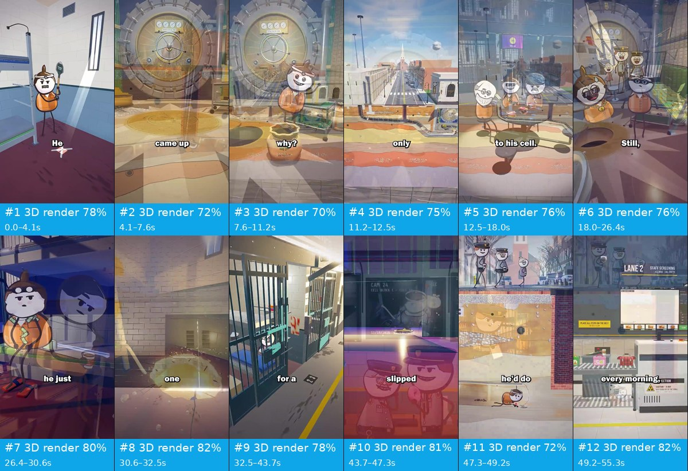
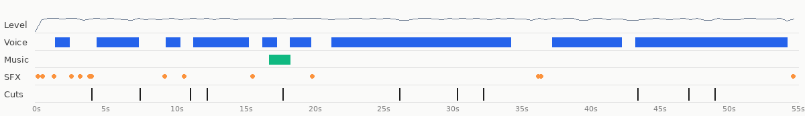

# How this video was made: The_Prisoner_Who_Tunneled_Into_a_Bank.mp4

**In one line**: hook: the strange act on screen in the first seconds → … → closing line lands back on the title claim
**How it was made**: 3D render 100%

- 0:55 · vertical 9:16 · 12 shots, 4.6s each on average
- Confidence 77%, based on: tool measurements + AI assistant reviewed 12 shots
- ⚠️ 1 points are uncertain, see “Open questions”

<!--mix-->



# Part one · Breakdown: how this video is built

## What makes it work

- **Opening 0.0–4.1s**: hook: the strange act on screen in the first seconds

## At a glance: picture, packaging, sound

Any short video splits into three layers: the picture, what is laid on top of it (subtitles, styled text, stickers), and the sound. Remake it one layer at a time.

| Layer | In this video | How to make it | Detail |
|---|---|---|---|
| **Picture** (base) | 3D render 12 shots | AI in 5 generations | “Remake it yourself” |
| **Packaging** (on top) | none | — | “Packaging layer” |
| **Sound** | voice（TTS voice-over）, 14 sound effects | voice: TTS voice-over; effects: add from a library at the listed times | “Sound” |

## Content and structure

- The narrative line below comes from reading each shot; the lines were not transcribed separately, subtitle text is under “Packaging layer”

**Narrative line**

Keep this line in a remake: same order, same job at each step, with the point refilled from your own cases, numbers and material, so it is more than a change of subject.

| Time | Shots | Job | What it says |
|---|---|---|---|
| 0.0–4.1s | #1 | grab attention | hook: the strange act on screen in the first seconds |
| 4.1–26.4s | #2–#6 | — | establish the place and the machine while the hero acts |
| 26.4–32.5s | #7, #8 | — | the diegetic sign/alarm flips the mood |
| 32.5–47.3s | #9, #10 | — | the literal payoff of the claim, POV thrill beat |
| 47.3–55.3s | #11, #12 | — | closing line lands back on the title claim |

## Shot list

| # | Frame | Time | What it says | Picture | Camera |
|---|---|---|---|---|---|
| 1 |  | 0:00.0 · 4.1s | grab attention: hook: the strange act on screen in the first… | Prisoner: 3D toon set with flat 2D character cards, word cap… | smooth move |
| 2 |  | 0:04.1 · 3.5s | establish the place and the machine while the hero acts | Prisoner: 3D toon set with flat 2D character cards, word cap… | smooth move |
| 3 |  | 0:07.6 · 3.6s | establish the place and the machine while the hero acts | Prisoner: 3D toon set with flat 2D character cards, word cap… | smooth move |
| 4 |  | 0:11.2 · 1.2s | establish the place and the machine while the hero acts | Prisoner: 3D toon set with flat 2D character cards, word cap… | smooth move |
| 5 |  | 0:12.5 · 5.5s | establish the place and the machine while the hero acts | Prisoner: 3D toon set with flat 2D character cards, word cap… | smooth move |
| 6 |  | 0:18.0 · 8.5s | establish the place and the machine while the hero acts | Prisoner: 3D toon set with flat 2D character cards, word cap… | smooth move |
| 7 |  | 0:26.4 · 4.2s | the diegetic sign/alarm flips the mood | Prisoner: 3D toon set with flat 2D character cards, word cap… | smooth move |
| 8 |  | 0:30.6 · 1.9s | the diegetic sign/alarm flips the mood | Prisoner: 3D toon set with flat 2D character cards, word cap… | smooth move |
| 9 |  | 0:32.5 · 11.2s | the literal payoff of the claim, POV thrill beat | Prisoner: 3D toon set with flat 2D character cards, word cap… | smooth move |
| 10 |  | 0:43.7 · 3.7s | the literal payoff of the claim, POV thrill beat | Prisoner: 3D toon set with flat 2D character cards, word cap… | smooth move |
| 11 |  | 0:47.3 · 1.9s | closing line lands back on the title claim | Prisoner: 3D toon set with flat 2D character cards, word cap… | smooth move |
| 12 |  | 0:49.2 · 6.1s | closing line lands back on the title claim | Prisoner: 3D toon set with flat 2D character cards, word cap… | smooth move |

## Cast, scenes and props

- No cast extracted this time (needs AI image reading)

## Camera and lighting

- Framing: shot size medium close-up 78%, medium shot 22%; camera angle eye level; subject is the in-focus region (no face; shot size is an estimate)
- Camera: moving camera (gimbal / handheld pan) 100%; typical move push-in
- Lighting: soft frontal light (flat light). Key light frontal (from the camera side; both sides of the subject about equally bright), at subject height; lighting ratio about 1.3:1 (0.4 stops); soft light (wide lit-to-shadow ramp); colour temperature cool (daylight / cool-white LED); background clearly blurred (shallow depth of field / portrait mode)
- (not live footage: the above describes the light in the picture, for generation prompts, not a shooting plan)
- Grade: natural (close to the original colours); normal saturation, normal contrast, lifted blacks (greyish shadows), overall cool

<details class="ref"><summary>Per-item measurements and image readings (12)</summary>

| Aspect | Item | Verdict | Sources |
|---|---|---|---|
| Framing | shot size | medium close-up | measured |
| Framing | camera angle | eye level | agent review |
| Framing | composition | subject big, faces above the caption band | agent review |
| Camera | camera support | virtual camera, hand-held feel via drift | measured: moving camera (gimbal / handheld pan); agent review |
| Camera | lens | 24-33 mm equivalent | agent review |
| Camera | speed | rest 0.6-1.8 px/f, travels 10-27 px/f | agent review |
| Lighting | location | set interior/exterior per place | agent review |
| Lighting | key light | diegetic practical (lamp/torch/window) | agent review |
| Lighting | soft / hard | soft light (wide lit-to-shadow ramp) | measured; agent review: soft toon steps |
| Lighting | colour temperature | cool (daylight / cool-white LED) | measured; agent review: place-owned warm/cool per DNA |
| Lighting | lighting set-up | hemisphere + directional key + practical point lights | agent review |
| Grade | colour grade | natural (close to the original colours) | measured; agent review: dark-mid luminance, sat 0.27-0.51, place-owned warmth |

- Note: lighting ratio, soft / hard, colour temperature and shot size are measured on the subject's pixels (the face when there is one, otherwise the in-focus region, which is an estimate); platform transcodes crush the shadows, so hardness and fill read conservative; camera angle, light source, catchlight and rim light follow the image readers. Where measurement and readers disagree, both are listed.

</details>

## Packaging layer (subtitles / styled text / stickers / sound-effect hits)

- Possible SFX hits (unconfirmed signal candidates) on: cut ×2
- No overlaid text or stickers detected (OCR off, text layer not analysed)

- Remake: import `packaging/subtitles.srt` into your editor and put in your own words; the styled version is `packaging/overlays.ass`

## Sound

**Voice**

- female-leaning
- Source: TTS voice-over
- Remake: TTS voice-over: CapCut text-to-speech or another TTS tool, with a similar voice and pace

**Sound effects** (14)

<details class="ref"><summary>all 14 sound effects</summary>

| Time | Listen | Type | Description | On screen |
|---|---|---|---|---|
| 0.22s | [listen](sfx/sfx_01.wav) | whoosh | — | — |
| 0.55s | [listen](sfx/sfx_02.wav) | whoosh | — | — |
| 1.41s | [listen](sfx/sfx_03.wav) | whoosh | — | — |
| 2.63s | [listen](sfx/sfx_04.wav) | whoosh | — | — |
| 3.26s | [listen](sfx/sfx_05.wav) | whoosh | — | — |
| 3.97s | [listen](sfx/sfx_06.wav) | ding | — | cut |
| 4.10s | [listen](sfx/sfx_07.wav) | whoosh | — | cut |
| 9.43s | [listen](sfx/sfx_08.wav) | whoosh | — | — |
| 10.81s | [listen](sfx/sfx_09.wav) | whoosh | — | — |
| 15.76s | [listen](sfx/sfx_10.wav) | whoosh | — | — |
| 20.11s | [listen](sfx/sfx_11.wav) | ding | — | — |
| 36.49s | [listen](sfx/sfx_12.wav) | ding | — | — |
| 36.64s | [listen](sfx/sfx_13.wav) | whoosh | — | — |
| 54.95s | [listen](sfx/sfx_14.wav) | whoosh | — | — |

</details>

- Remake: take a similar effect from your editor's library and place it at that time

<details class="ref"><summary>Sound measurements and evidence</summary>



- Loudness -17.2 dBFS, peak -2.3 dBFS
- sound runs across cuts, laid in post as one bed (background changes 8.0dB at cuts vs 5.3dB within shots)
- Voice on 73% of the duration, pitch about 202.3Hz
- Voice source: TTS voice-over (TTS voice-over 64%, human recording 27%, native dialogue from the AI video model 9%)
  - Voice and background sound run across cuts: the voice-over was laid on separately in post (TTS or a human voice-over)
- Effects source: added in post from an SFX library / editor (added in post from an SFX library / editor 57%, generated with the picture by the video model (native audio) 29%, location sound 14%)
  - Cartoon SFX in 3D / animated videos are also often procedurally synthesised or added from a library (e.g. the capsule-cinema plush recipe synthesises them)

</details>

## Open questions

- No AI listened to the soundtrack (the review covered the picture only): real voice versus TTS is inferred from the waveform; the effects were picked off the mix where the sound jumps, so plosives and drum hits can be counted too. Play the stems and each effect under “Sound” to check

# Part two · Remake plan

Planned for **MiniMax H3 / H3 Max**: ≤15 s per call, several shots per call, no reference video, first / last frame, native sound. Name another model and the split, lengths and prompts are redone for it.

## Remake it yourself: do it in this order

Copy the method and the rhythm, not the pictures: keep what each part does and fill it with your own content and material.

This is a 3D / animation. Do the steps in this order; the detail for each is in the matching subsection below.

1. **Write the content**: write yours in the same 5 steps as the original (narrative line under “Content and structure”)
2. **Generate**: 5 calls (55 s), several shots each. Each shot gets one source frame for composition (subtitles erased, in `remake/refs/`), the swapped-in people, animals and products get reference images, and the prompt lists the shots in order
3. **Adapt the prompts to your model**: the prompts in this report are generic, and every model reads them differently (how shots are split, how references are addressed, how dialogue is written). Before generating, rewrite them following the official prompt guide of the model you actually use, or have the agent refine them with that model's prompting skill; notes for MiniMax H3 / H3 Max at the top of “AI generation”
4. **Voice**: the original is TTS voice-over; record it yourself or use TTS; delivery per “Acting and emotion”
5. **Edit**: follow the order and lengths in the shot list; the original has 12 shots at 4.6s each; 7 transitions under “Edit”
6. **Subtitles and styled text**: timing and style under “Packaging layer”
7. **Sound effects**: 14; place similar ones from a library at the times under “Sound”
8. **Put it together and compare**: hand the shots you made to the agent; it places them on the original timeline, keeps the original where yours are missing, and renders a side-by-side comparison with the original

### AI generation

**5 generations, 55 s in total**

> ⚠️ G1、G2、G3、G4、G5: the prompts are still generic drafts. Rewrite them in MiniMax H3 / H3 Max's official format (or have the agent write them with that model's prompting skill) into `remake/prompts.json`, numbering images in the unit's reference order; `rea-video plan` then checks the format.

| Part | Shots | Time | Length | Prepare |
|---|---|---|---|---|
| G1 | #1 | 0.0–4.1s | 4.1s | reference images |
| G2 | #2–#5 | 4.1–18.0s | 13.9s | reference images |
| G3 | #6–#8 | 18.0–32.5s | 14.5s | reference images |
| G4 | #9, #10 | 32.5–47.3s | 14.9s | reference images |
| G5 | #11, #12 | 47.3–55.3s | 8.0s | reference images |

<details class="ref"><summary>Why it is split this way</summary>

- Grouping: consecutive shots share a call where they fit, ≤15s per call, ≤4 shots; a long stretch is cut at a scene change first
- Inputs: the model takes no reference video: one source frame per shot (subtitles erased) fixes composition, swapped-in things get their own images
- Audio: the model can generate action sound effects and ambience along with the picture; voice-over is better done as separate TTS and mixed in, so copy and timing stay editable

</details>

<details><summary>G1 · shots #1 · 4.1s</summary>

- reference images: source frames of shots #1 (subtitles erased)
- Acting #1: brow-driven acting o · dot eyes + thick black brows (voice first, then drive, see “Acting and emotion”)

Draft prompt (generic; rewrite it in MiniMax H3 / H3 Max's format into remake/prompts.json before generating):

```text
Generate the shots below in order in one go, hard cuts between them; each shot takes composition, size and camera from its source frame image. Vertical 9:16; soft frontal light (flat light), soft light (wide lit-to-shadow ramp), cool (daylight / cool-white LED), background clearly blurred (shallow depth of field / portrait mode). No subtitles, captions or watermarks in the picture.
Prisoner: 3D toon set with flat 2D character cards, word caption synced to the Bangla narration; place-lit (warm torch/gold or cool night) per the channel DNA.Acting: dot eyes + thick black brows (composition: @图片1)
```

</details>

<details><summary>G2 · shots #2–#5 · 13.9s</summary>

- reference images: source frames of shots #2、#3、#4、#5 (subtitles erased)
- Acting #2 (key): brow-driven acting o · dot eyes + thick black brows (voice first, then drive, see “Acting and emotion”)
- Acting #3 (key): brow-driven acting o · dot eyes + thick black brows (voice first, then drive, see “Acting and emotion”)
- Acting #4 (key): brow-driven acting o · dot eyes + thick black brows (voice first, then drive, see “Acting and emotion”)
- Acting #5 (key): brow-driven acting o · dot eyes + thick black brows (voice first, then drive, see “Acting and emotion”)

Draft prompt (generic; rewrite it in MiniMax H3 / H3 Max's format into remake/prompts.json before generating):

```text
Generate the shots below in order in one go, hard cuts between them; each shot takes composition, size and camera from its source frame image. Vertical 9:16; soft frontal light (flat light), soft light (wide lit-to-shadow ramp), cool (daylight / cool-white LED), background clearly blurred (shallow depth of field / portrait mode). No subtitles, captions or watermarks in the picture.
Shot 1 (from 0.0s): Prisoner: 3D toon set with flat 2D character cards, word caption synced to the Bangla narration; place-lit (warm torch/gold or cool night) per the channel DNA.Acting: dot eyes + thick black brows (composition: @图片1)
Shot 2 (from 3.5s): Prisoner: 3D toon set with flat 2D character cards, word caption synced to the Bangla narration; place-lit (warm torch/gold or cool night) per the channel DNA.Acting: dot eyes + thick black brows (composition: @图片2)
Shot 3 (from 7.1s): Prisoner: 3D toon set with flat 2D character cards, word caption synced to the Bangla narration; place-lit (warm torch/gold or cool night) per the channel DNA.Acting: dot eyes + thick black brows (composition: @图片3)
Shot 4 (from 8.4s): Prisoner: 3D toon set with flat 2D character cards, word caption synced to the Bangla narration; place-lit (warm torch/gold or cool night) per the channel DNA.Acting: dot eyes + thick black brows (composition: @图片4)
```

</details>

<details><summary>G3 · shots #6–#8 · 14.5s</summary>

- reference images: source frames of shots #6、#7、#8 (subtitles erased)
- Acting #6 (key): brow-driven acting o · dot eyes + thick black brows (voice first, then drive, see “Acting and emotion”)
- Acting #7 (key): brow-driven acting o · dot eyes + thick black brows (voice first, then drive, see “Acting and emotion”)
- Acting #8 (key): brow-driven acting o · dot eyes + thick black brows (voice first, then drive, see “Acting and emotion”)

Draft prompt (generic; rewrite it in MiniMax H3 / H3 Max's format into remake/prompts.json before generating):

```text
Generate the shots below in order in one go, hard cuts between them; each shot takes composition, size and camera from its source frame image. Vertical 9:16; soft frontal light (flat light), soft light (wide lit-to-shadow ramp), cool (daylight / cool-white LED), background clearly blurred (shallow depth of field / portrait mode). No subtitles, captions or watermarks in the picture.
Shot 1 (from 0.0s): Prisoner: 3D toon set with flat 2D character cards, word caption synced to the Bangla narration; place-lit (warm torch/gold or cool night) per the channel DNA.Acting: dot eyes + thick black brows (composition: @图片1)
Shot 2 (from 8.5s): Prisoner: 3D toon set with flat 2D character cards, word caption synced to the Bangla narration; place-lit (warm torch/gold or cool night) per the channel DNA.Acting: dot eyes + thick black brows (composition: @图片2)
Shot 3 (from 12.6s): Prisoner: 3D toon set with flat 2D character cards, word caption synced to the Bangla narration; place-lit (warm torch/gold or cool night) per the channel DNA.Acting: dot eyes + thick black brows (composition: @图片3)
```

</details>

<details><summary>G4 · shots #9, #10 · 14.9s</summary>

- reference images: source frames of shots #9、#10 (subtitles erased)
- Acting #9 (key): brow-driven acting o · dot eyes + thick black brows (voice first, then drive, see “Acting and emotion”)
- Acting #10 (key): brow-driven acting o · dot eyes + thick black brows (voice first, then drive, see “Acting and emotion”)

Draft prompt (generic; rewrite it in MiniMax H3 / H3 Max's format into remake/prompts.json before generating):

```text
Generate the shots below in order in one go, hard cuts between them; each shot takes composition, size and camera from its source frame image. Vertical 9:16; soft frontal light (flat light), soft light (wide lit-to-shadow ramp), cool (daylight / cool-white LED), background clearly blurred (shallow depth of field / portrait mode). No subtitles, captions or watermarks in the picture.
Shot 1 (from 0.0s): Prisoner: 3D toon set with flat 2D character cards, word caption synced to the Bangla narration; place-lit (warm torch/gold or cool night) per the channel DNA.Acting: dot eyes + thick black brows (composition: @图片1)
Shot 2 (from 11.2s): Prisoner: 3D toon set with flat 2D character cards, word caption synced to the Bangla narration; place-lit (warm torch/gold or cool night) per the channel DNA.Acting: dot eyes + thick black brows (composition: @图片2)
```

</details>

<details><summary>G5 · shots #11, #12 · 8.0s</summary>

- reference images: source frames of shots #11、#12 (subtitles erased)
- Acting #11 (key): brow-driven acting o · dot eyes + thick black brows (voice first, then drive, see “Acting and emotion”)
- Acting #12 (key): brow-driven acting o · dot eyes + thick black brows (voice first, then drive, see “Acting and emotion”)

Draft prompt (generic; rewrite it in MiniMax H3 / H3 Max's format into remake/prompts.json before generating):

```text
Generate the shots below in order in one go, hard cuts between them; each shot takes composition, size and camera from its source frame image. Vertical 9:16; soft frontal light (flat light), soft light (wide lit-to-shadow ramp), cool (daylight / cool-white LED), background clearly blurred (shallow depth of field / portrait mode). No subtitles, captions or watermarks in the picture.
Shot 1 (from 0.0s): Prisoner: 3D toon set with flat 2D character cards, word caption synced to the Bangla narration; place-lit (warm torch/gold or cool night) per the channel DNA.Acting: dot eyes + thick black brows (composition: @图片1)
Shot 2 (from 1.9s): Prisoner: 3D toon set with flat 2D character cards, word caption synced to the Bangla narration; place-lit (warm torch/gold or cool night) per the channel DNA.Acting: dot eyes + thick black brows (composition: @图片2)
```

</details>

### Acting and emotion

In a prompt, describe the visible expression and movement rather than words like “happy” or “sad”, and keep it smaller rather than bigger (strong emotion words tend to give mask faces and forced smiles); get the expression right in the first frame; for shots with lines, make the voice with its delivery first and let the picture act to it. For generated shots the Face and Movement below are already in the generation-unit prompts.

| Shot | Who | Emotion (strength) | Face | Movement / change | Delivery | How to get it |
|---|---|---|---|---|---|---|
| #1 | hero + supporting cards | brow-driven acting o | dot eyes + thick black brows | — | Bangla narration (real human), captions word-synced | voice first, then drive |
| #2 | hero + supporting cards | brow-driven acting o ★key | dot eyes + thick black brows | — | Bangla narration (real human), captions word-synced | voice first, then drive |
| #3 | hero + supporting cards | brow-driven acting o ★key | dot eyes + thick black brows | — | Bangla narration (real human), captions word-synced | voice first, then drive |
| #4 | hero + supporting cards | brow-driven acting o ★key | dot eyes + thick black brows | — | Bangla narration (real human), captions word-synced | voice first, then drive |
| #5 | hero + supporting cards | brow-driven acting o ★key | dot eyes + thick black brows | — | Bangla narration (real human), captions word-synced | voice first, then drive |
| #6 | hero + supporting cards | brow-driven acting o ★key | dot eyes + thick black brows | — | Bangla narration (real human), captions word-synced | voice first, then drive |
| #7 | hero + supporting cards | brow-driven acting o ★key | dot eyes + thick black brows | — | Bangla narration (real human), captions word-synced | voice first, then drive |
| #8 | hero + supporting cards | brow-driven acting o ★key | dot eyes + thick black brows | — | Bangla narration (real human), captions word-synced | voice first, then drive |
| #9 | hero + supporting cards | brow-driven acting o ★key | dot eyes + thick black brows | — | Bangla narration (real human), captions word-synced | voice first, then drive |
| #10 | hero + supporting cards | brow-driven acting o ★key | dot eyes + thick black brows | — | Bangla narration (real human), captions word-synced | voice first, then drive |
| #11 | hero + supporting cards | brow-driven acting o ★key | dot eyes + thick black brows | — | Bangla narration (real human), captions word-synced | voice first, then drive |
| #12 | hero + supporting cards | brow-driven acting o ★key | dot eyes + thick black brows | — | Bangla narration (real human), captions word-synced | voice first, then drive |

- **voice first, then drive**: Speaking: make the voice with its delivery first (TTS with tone tags only where the emotion turns, or a real recording), then drive mouth and face from that audio (Kling Avatar, OmniHuman); with a video model that makes sound itself, put the line and its delivery in the prompt together

### Edit

- Cut in the order and lengths of the shot list
- Rhythm: 11.9 cuts per minute, 4.61s average shot; no live-action shots; transitions cut×4, dissolve×6, slide×1

**Transitions**

| Time | Into shot | Transition |
|---|---|---|
| 3.4–5.0s | #2 | dissolve, 1.6s |
| 12.4–12.7s | #5 | dissolve, 0.3s |
| 17.8–18.2s | #6 | dissolve, 0.4s |
| 25.9–26.9s | #7 | slide, rightwards, both pictures move, 1.0s |
| 30.5–30.8s | #8 | dissolve, 0.3s |
| 43.6–43.8s | #10 | dissolve, 0.2s |
| 49.1–49.5s | #12 | dissolve, 0.4s |

## Appendix

### Shot by shot

Each shot has two parts: what is visible on screen, and how the tools infer it was made (with the basis); remake prompts last. Folded by default.

<details class="ref"><summary>#1 00:00.000–00:04.100 · 3D render</summary>


**Visible on screen** (check against the frames)
- Picture: Prisoner: 3D toon set with flat 2D character cards, word caption synced to the Bangla narration; place-lit (warm torch/gold or cool night) per the channel DNA.
- Acting: brow-driven acting o · dot eyes + thick black brows; delivery: Bangla narration (real human), captions word-synced
- Camera / lighting: medium close-up; eye level; virtual camera, hand-held feel via drift; soft frontal light (flat light); key light frontal (from the camera side; both sides of the subject about equally bright); lighting ratio about 1.3:1 (0.4 stops); soft light (wide lit-to-shadow ramp)
- [agent-zai-glm review] white capsule-head 2D character card(s) inside a textured low-poly 3D set — the @RicksClips3000 signature production family
- [agent-zai-glm review] flat-shaded toon lighting with diegetic practical pools (lamp/torch/screen), painted word caption overlay
- [agent-zai-glm review] no camera shake / sensor artifacts beyond the YouTube transcode grain the tool measured

**How it was made, as inferred by the tools** (inferred, not seen)
- Inference: 3D render 74%, live action 6%, AI-generated video 6% (fused_agent)
- Material: rendered by the creator
- Basis (tool measurements, not necessarily visible to the eye):
  - Photographic texture: noise σ=0.16, 165 colours, 24% flat blocks
  - The whole file is native 30fps and photographic shots carry no 24fps-source duplicate frames (91% of the duration): typical of straight-from-phone footage, generators mostly output 24fps

- Remake: 3D render: a video model gives an approximation (see the generation units); for precise multiple angles, model in 3D and render in Blender

</details>

<details class="ref"><summary>#2 00:04.100–00:07.600 · 3D render</summary>


**Visible on screen** (check against the frames)
- Picture: Prisoner: 3D toon set with flat 2D character cards, word caption synced to the Bangla narration; place-lit (warm torch/gold or cool night) per the channel DNA.
- Acting: brow-driven acting o · dot eyes + thick black brows; delivery: Bangla narration (real human), captions word-synced
- Camera / lighting: medium shot; eye level; virtual camera, hand-held feel via drift; soft frontal light (flat light); key light frontal (from the camera side; both sides of the subject about equally bright); lighting ratio about 1.2:1 (0.3 stops); soft light (wide lit-to-shadow ramp)
- [agent-zai-glm review] white capsule-head 2D character card(s) inside a textured low-poly 3D set — the @RicksClips3000 signature production family
- [agent-zai-glm review] flat-shaded toon lighting with diegetic practical pools (lamp/torch/screen), painted word caption overlay
- [agent-zai-glm review] no camera shake / sensor artifacts beyond the YouTube transcode grain the tool measured

**How it was made, as inferred by the tools** (inferred, not seen)
- Inference: 3D render 68%, live action 9%, AI-generated video 7% (fused_agent)
- Material: rendered by the creator
- Basis (tool measurements, not necessarily visible to the eye):
  - Photographic texture: noise σ=0.25, 216 colours, 12% flat blocks
  - The whole file is native 30fps and photographic shots carry no 24fps-source duplicate frames (91% of the duration): typical of straight-from-phone footage, generators mostly output 24fps
  - Temporal noise 1.37, 22% of pixels unchanged frame to frame: sensor noise is present, consistent with live action

- Remake: 3D render: a video model gives an approximation (see the generation units); for precise multiple angles, model in 3D and render in Blender

</details>

<details class="ref"><summary>#3 00:07.600–00:11.233 · 3D render</summary>


**Visible on screen** (check against the frames)
- Picture: Prisoner: 3D toon set with flat 2D character cards, word caption synced to the Bangla narration; place-lit (warm torch/gold or cool night) per the channel DNA.
- Acting: brow-driven acting o · dot eyes + thick black brows; delivery: Bangla narration (real human), captions word-synced
- Camera / lighting: medium close-up; eye level; virtual camera, hand-held feel via drift; three-quarter key + fill (standard set-up); key light frame right, three-quarter front; lighting ratio about 1.7:1 (0.7 stops); medium-soft
- [agent-zai-glm review] white capsule-head 2D character card(s) inside a textured low-poly 3D set — the @RicksClips3000 signature production family
- [agent-zai-glm review] flat-shaded toon lighting with diegetic practical pools (lamp/torch/screen), painted word caption overlay
- [agent-zai-glm review] no camera shake / sensor artifacts beyond the YouTube transcode grain the tool measured

**How it was made, as inferred by the tools** (inferred, not seen)
- Inference: 3D render 66%, live action 10%, AI-generated video 7% (fused_agent)
- Material: rendered by the creator
- Basis (tool measurements, not necessarily visible to the eye):
  - Photographic texture: noise σ=0.38, 171 colours, 12% flat blocks
  - The whole file is native 30fps and photographic shots carry no 24fps-source duplicate frames (91% of the duration): typical of straight-from-phone footage, generators mostly output 24fps
  - Temporal noise 1.31, 25% of pixels unchanged frame to frame: sensor noise is present, consistent with live action

- Remake: 3D render: a video model gives an approximation (see the generation units); for precise multiple angles, model in 3D and render in Blender

</details>

<details class="ref"><summary>#4 00:11.233–00:12.467 · 3D render</summary>


**Visible on screen** (check against the frames)
- Picture: Prisoner: 3D toon set with flat 2D character cards, word caption synced to the Bangla narration; place-lit (warm torch/gold or cool night) per the channel DNA.
- Acting: brow-driven acting o · dot eyes + thick black brows; delivery: Bangla narration (real human), captions word-synced
- Camera / lighting: medium close-up; eye level; virtual camera, hand-held feel via drift; high key (bright overall, almost no shadows); key light frontal (from the camera side; both sides of the subject about equally bright); lighting ratio about 1.3:1 (0.4 stops); soft light (almost no lit / shadow edge)
- [agent-zai-glm review] white capsule-head 2D character card(s) inside a textured low-poly 3D set — the @RicksClips3000 signature production family
- [agent-zai-glm review] flat-shaded toon lighting with diegetic practical pools (lamp/torch/screen), painted word caption overlay
- [agent-zai-glm review] no camera shake / sensor artifacts beyond the YouTube transcode grain the tool measured

**How it was made, as inferred by the tools** (inferred, not seen)
- Inference: 3D render 71%, live action 7%, AI-generated video 7% (fused_agent)
- Material: rendered by the creator
- Basis (tool measurements, not necessarily visible to the eye):
  - Photographic texture: noise σ=0.21, 223 colours, 13% flat blocks
  - The whole file is native 30fps and photographic shots carry no 24fps-source duplicate frames (91% of the duration): typical of straight-from-phone footage, generators mostly output 24fps

- Remake: 3D render: a video model gives an approximation (see the generation units); for precise multiple angles, model in 3D and render in Blender

</details>

<details class="ref"><summary>#5 00:12.467–00:17.967 · 3D render</summary>


**Visible on screen** (check against the frames)
- Picture: Prisoner: 3D toon set with flat 2D character cards, word caption synced to the Bangla narration; place-lit (warm torch/gold or cool night) per the channel DNA.
- Acting: brow-driven acting o · dot eyes + thick black brows; delivery: Bangla narration (real human), captions word-synced
- Camera / lighting: medium close-up; eye level; virtual camera, hand-held feel via drift; soft frontal light (flat light); key light frontal (from the camera side; both sides of the subject about equally bright); lighting ratio about 1.2:1 (0.3 stops); soft light (wide lit-to-shadow ramp)
- [agent-zai-glm review] white capsule-head 2D character card(s) inside a textured low-poly 3D set — the @RicksClips3000 signature production family
- [agent-zai-glm review] flat-shaded toon lighting with diegetic practical pools (lamp/torch/screen), painted word caption overlay
- [agent-zai-glm review] no camera shake / sensor artifacts beyond the YouTube transcode grain the tool measured

**How it was made, as inferred by the tools** (inferred, not seen)
- Inference: 3D render 72%, live action 7%, AI-generated video 6% (fused_agent)
- Material: rendered by the creator
- Basis (tool measurements, not necessarily visible to the eye):
  - Photographic texture: noise σ=0.21, 142 colours, 20% flat blocks
  - The whole file is native 30fps and photographic shots carry no 24fps-source duplicate frames (91% of the duration): typical of straight-from-phone footage, generators mostly output 24fps
  - Temporal noise 1.04, 36% of pixels unchanged frame to frame: sensor noise is present, consistent with live action

- Remake: 3D render: a video model gives an approximation (see the generation units); for precise multiple angles, model in 3D and render in Blender

</details>

<details class="ref"><summary>#6 00:17.967–00:26.433 · 3D render</summary>


**Visible on screen** (check against the frames)
- Picture: Prisoner: 3D toon set with flat 2D character cards, word caption synced to the Bangla narration; place-lit (warm torch/gold or cool night) per the channel DNA.
- Acting: brow-driven acting o · dot eyes + thick black brows; delivery: Bangla narration (real human), captions word-synced
- Camera / lighting: medium shot; eye level; virtual camera, hand-held feel via drift; three-quarter key + fill (standard set-up); key light frame right, three-quarter front; lighting ratio about 1.9:1 (0.9 stops); soft light (wide lit-to-shadow ramp)
- [agent-zai-glm review] white capsule-head 2D character card(s) inside a textured low-poly 3D set — the @RicksClips3000 signature production family
- [agent-zai-glm review] flat-shaded toon lighting with diegetic practical pools (lamp/torch/screen), painted word caption overlay
- [agent-zai-glm review] no camera shake / sensor artifacts beyond the YouTube transcode grain the tool measured

**How it was made, as inferred by the tools** (inferred, not seen)
- Inference: 3D render 72%, live action 7%, AI-generated video 7% (fused_agent)
- Material: rendered by the creator
- Basis (tool measurements, not necessarily visible to the eye):
  - Photographic texture: noise σ=0.16, 171 colours, 20% flat blocks
  - The whole file is native 30fps and photographic shots carry no 24fps-source duplicate frames (91% of the duration): typical of straight-from-phone footage, generators mostly output 24fps
  - Temporal noise 0.97, 39% of pixels unchanged frame to frame: sensor noise is present, consistent with live action

- Remake: 3D render: a video model gives an approximation (see the generation units); for precise multiple angles, model in 3D and render in Blender

</details>

<details class="ref"><summary>#7 00:26.433–00:30.600 · 3D render</summary>


**Visible on screen** (check against the frames)
- Picture: Prisoner: 3D toon set with flat 2D character cards, word caption synced to the Bangla narration; place-lit (warm torch/gold or cool night) per the channel DNA.
- Acting: brow-driven acting o · dot eyes + thick black brows; delivery: Bangla narration (real human), captions word-synced
- Camera / lighting: medium close-up; eye level; virtual camera, hand-held feel via drift; soft frontal light (flat light); key light frontal (from the camera side; both sides of the subject about equally bright); lighting ratio about 1.3:1 (0.3 stops); medium-soft
- [agent-zai-glm review] white capsule-head 2D character card(s) inside a textured low-poly 3D set — the @RicksClips3000 signature production family
- [agent-zai-glm review] flat-shaded toon lighting with diegetic practical pools (lamp/torch/screen), painted word caption overlay
- [agent-zai-glm review] no camera shake / sensor artifacts beyond the YouTube transcode grain the tool measured

**How it was made, as inferred by the tools** (inferred, not seen)
- Inference: 3D render 76%, live action 6%, AI-generated video 5% (fused_agent)
- Material: rendered by the creator
- Basis (tool measurements, not necessarily visible to the eye):
  - The whole file is native 30fps and photographic shots carry no 24fps-source duplicate frames (91% of the duration): typical of straight-from-phone footage, generators mostly output 24fps
  - Temporal noise 1.00, 35% of pixels unchanged frame to frame: sensor noise is present, consistent with live action

- Remake: 3D render: a video model gives an approximation (see the generation units); for precise multiple angles, model in 3D and render in Blender

</details>

<details class="ref"><summary>#8 00:30.600–00:32.467 · 3D render</summary>


**Visible on screen** (check against the frames)
- Picture: Prisoner: 3D toon set with flat 2D character cards, word caption synced to the Bangla narration; place-lit (warm torch/gold or cool night) per the channel DNA.
- Acting: brow-driven acting o · dot eyes + thick black brows; delivery: Bangla narration (real human), captions word-synced
- Camera / lighting: medium close-up; eye level; virtual camera, hand-held feel via drift; three-quarter key + fill (standard set-up); key light frame left, three-quarter front; lighting ratio about 1.8:1 (0.8 stops); medium-soft
- [agent-zai-glm review] white capsule-head 2D character card(s) inside a textured low-poly 3D set — the @RicksClips3000 signature production family
- [agent-zai-glm review] flat-shaded toon lighting with diegetic practical pools (lamp/torch/screen), painted word caption overlay
- [agent-zai-glm review] no camera shake / sensor artifacts beyond the YouTube transcode grain the tool measured

**How it was made, as inferred by the tools** (inferred, not seen)
- Inference: 3D render 77%, live action 5%, AI-generated video 5% (fused_agent)
- Material: rendered by the creator
- Basis (tool measurements, not necessarily visible to the eye):
  - The whole file is native 30fps and photographic shots carry no 24fps-source duplicate frames (91% of the duration): typical of straight-from-phone footage, generators mostly output 24fps
  - Temporal noise 1.01, 37% of pixels unchanged frame to frame: sensor noise is present, consistent with live action

- Remake: 3D render: a video model gives an approximation (see the generation units); for precise multiple angles, model in 3D and render in Blender

</details>

<details class="ref"><summary>#9 00:32.467–00:43.667 · 3D render</summary>


**Visible on screen** (check against the frames)
- Picture: Prisoner: 3D toon set with flat 2D character cards, word caption synced to the Bangla narration; place-lit (warm torch/gold or cool night) per the channel DNA.
- Acting: brow-driven acting o · dot eyes + thick black brows; delivery: Bangla narration (real human), captions word-synced
- Camera / lighting: medium close-up; eye level; virtual camera, hand-held feel via drift; soft frontal light (flat light); key light frontal (from the camera side; both sides of the subject about equally bright); lighting ratio about 1.2:1 (0.2 stops); soft light (wide lit-to-shadow ramp)
- [agent-zai-glm review] white capsule-head 2D character card(s) inside a textured low-poly 3D set — the @RicksClips3000 signature production family
- [agent-zai-glm review] flat-shaded toon lighting with diegetic practical pools (lamp/torch/screen), painted word caption overlay
- [agent-zai-glm review] no camera shake / sensor artifacts beyond the YouTube transcode grain the tool measured

**How it was made, as inferred by the tools** (inferred, not seen)
- Inference: 3D render 73%, live action 7%, AI-generated video 6% (fused_agent)
- Material: rendered by the creator
- Basis (tool measurements, not necessarily visible to the eye):
  - Photographic texture: noise σ=0.22, 239 colours, 13% flat blocks
  - The whole file is native 30fps and photographic shots carry no 24fps-source duplicate frames (91% of the duration): typical of straight-from-phone footage, generators mostly output 24fps
  - Temporal noise 1.25, 25% of pixels unchanged frame to frame: sensor noise is present, consistent with live action

- Remake: 3D render: a video model gives an approximation (see the generation units); for precise multiple angles, model in 3D and render in Blender

</details>

<details class="ref"><summary>#10 00:43.667–00:47.333 · 3D render</summary>


**Visible on screen** (check against the frames)
- Picture: Prisoner: 3D toon set with flat 2D character cards, word caption synced to the Bangla narration; place-lit (warm torch/gold or cool night) per the channel DNA.
- Acting: brow-driven acting o · dot eyes + thick black brows; delivery: Bangla narration (real human), captions word-synced
- Camera / lighting: medium close-up; eye level; virtual camera, hand-held feel via drift; soft frontal light (flat light); key light frontal (from the camera side; both sides of the subject about equally bright); lighting ratio about 1.3:1 (0.4 stops); medium-soft
- [agent-zai-glm review] white capsule-head 2D character card(s) inside a textured low-poly 3D set — the @RicksClips3000 signature production family
- [agent-zai-glm review] flat-shaded toon lighting with diegetic practical pools (lamp/torch/screen), painted word caption overlay
- [agent-zai-glm review] no camera shake / sensor artifacts beyond the YouTube transcode grain the tool measured

**How it was made, as inferred by the tools** (inferred, not seen)
- Inference: 3D render 77%, live action 5%, AI-generated video 5% (fused_agent)
- Material: rendered by the creator
- Basis (tool measurements, not necessarily visible to the eye):
  - The whole file is native 30fps and photographic shots carry no 24fps-source duplicate frames (91% of the duration): typical of straight-from-phone footage, generators mostly output 24fps
  - Temporal noise 1.16, 35% of pixels unchanged frame to frame: sensor noise is present, consistent with live action

- Remake: 3D render: a video model gives an approximation (see the generation units); for precise multiple angles, model in 3D and render in Blender

</details>

<details class="ref"><summary>#11 00:47.333–00:49.233 · 3D render</summary>


**Visible on screen** (check against the frames)
- Picture: Prisoner: 3D toon set with flat 2D character cards, word caption synced to the Bangla narration; place-lit (warm torch/gold or cool night) per the channel DNA.
- Acting: brow-driven acting o · dot eyes + thick black brows; delivery: Bangla narration (real human), captions word-synced
- Camera / lighting: medium close-up; eye level; virtual camera, hand-held feel via drift; high key (bright overall, almost no shadows); key light frontal (from the camera side; both sides of the subject about equally bright); lighting ratio about 1.0:1 (0.0 stops); soft light (almost no lit / shadow edge)
- [agent-zai-glm review] white capsule-head 2D character card(s) inside a textured low-poly 3D set — the @RicksClips3000 signature production family
- [agent-zai-glm review] flat-shaded toon lighting with diegetic practical pools (lamp/torch/screen), painted word caption overlay
- [agent-zai-glm review] no camera shake / sensor artifacts beyond the YouTube transcode grain the tool measured

**How it was made, as inferred by the tools** (inferred, not seen)
- Inference: 3D render 67%, live action 8%, AI-generated video 8% (fused_agent)
- Material: rendered by the creator
- Basis (tool measurements, not necessarily visible to the eye):
  - Photographic texture: noise σ=0.37, 233 colours, 8% flat blocks
  - The whole file is native 30fps and photographic shots carry no 24fps-source duplicate frames (91% of the duration): typical of straight-from-phone footage, generators mostly output 24fps

- Remake: 3D render: a video model gives an approximation (see the generation units); for precise multiple angles, model in 3D and render in Blender

</details>

<details class="ref"><summary>#12 00:49.233–00:55.300 · 3D render</summary>


**Visible on screen** (check against the frames)
- Picture: Prisoner: 3D toon set with flat 2D character cards, word caption synced to the Bangla narration; place-lit (warm torch/gold or cool night) per the channel DNA.
- Acting: brow-driven acting o · dot eyes + thick black brows; delivery: Bangla narration (real human), captions word-synced
- Camera / lighting: medium close-up; eye level; virtual camera, hand-held feel via drift; soft frontal light (flat light); key light frontal (from the camera side; both sides of the subject about equally bright); lighting ratio about 1.3:1 (0.4 stops); soft light (wide lit-to-shadow ramp)
- [agent-zai-glm review] white capsule-head 2D character card(s) inside a textured low-poly 3D set — the @RicksClips3000 signature production family
- [agent-zai-glm review] flat-shaded toon lighting with diegetic practical pools (lamp/torch/screen), painted word caption overlay
- [agent-zai-glm review] no camera shake / sensor artifacts beyond the YouTube transcode grain the tool measured

**How it was made, as inferred by the tools** (inferred, not seen)
- Inference: 3D render 77%, AI-generated video 6%, live action 5% (fused_agent)
- Material: rendered by the creator
- Basis (tool measurements, not necessarily visible to the eye):
  - Platform transcode (YouTube) has compressed the sensor noise away: noise cues no longer apply, live action vs AI rests on frame rate and picture content

- Remake: 3D render: a video model gives an approximation (see the generation units); for precise multiple angles, model in 3D and render in Blender

</details>

### Metadata clues

- Encoder: `Lavf59.27.100`
- platform: YouTube

### Notes

- Deterministic forensics is reliable on motion, whole-frame pan/zoom, rendered texture and 24→30 fps conversion; telling live action from AI from 3D needs image reading (a VLM or an AI assistant's review), and a look at the frames yourself.
- Platform transcoding usually strips metadata; missing metadata proves nothing.
- The full data is in `breakdown.json`; the package for models starts at `VIDEO.md`.

---

Made with [REA-VIDEO](https://github.com/JuneYaooo/rea-video) · https://github.com/JuneYaooo/rea-video
