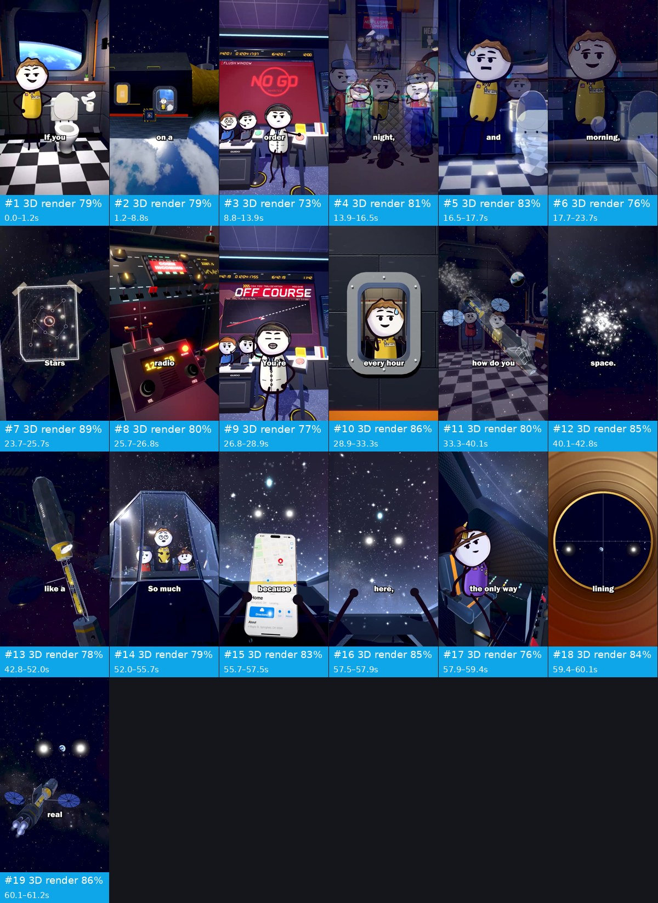
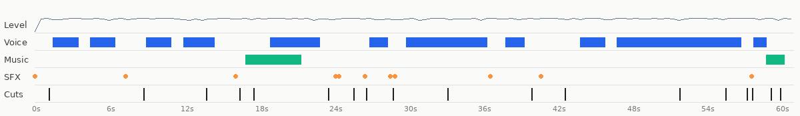

# How this video was made: Why_Astronauts_Cant_Flush_in_Space.mp4

**In one line**: hook: the strange act on screen in the first seconds → … → closing line lands back on the title claim
**How it was made**: Mixed production: 3D render 100%

- 1:01 · vertical 9:16 · 19 shots, 3.2s each on average
- Confidence 80%, based on: tool measurements + AI assistant reviewed 19 shots
- ⚠️ 1 points are uncertain, see “Open questions”

<!--mix-->



# Part one · Breakdown: how this video is built

## What makes it work

- **Opening 0.0–8.8s**: hook: the strange act on screen in the first seconds

## At a glance: picture, packaging, sound

Any short video splits into three layers: the picture, what is laid on top of it (subtitles, styled text, stickers), and the sound. Remake it one layer at a time.

| Layer | In this video | How to make it | Detail |
|---|---|---|---|
| **Picture** (base) | 3D render 19 shots | AI in 6 generations | “Remake it yourself” |
| **Packaging** (on top) | graphic | add in the editor: subtitles, styled text and stickers by the timeline | “Packaging layer” |
| **Sound** | voice（TTS voice-over）, 11 sound effects | voice: TTS voice-over; effects: add from a library at the listed times | “Sound” |

## Content and structure

- The narrative line below comes from reading each shot; the lines were not transcribed separately, subtitle text is under “Packaging layer”

**Narrative line**

Keep this line in a remake: same order, same job at each step, with the point refilled from your own cases, numbers and material, so it is more than a change of subject.

| Time | Shots | Job | What it says |
|---|---|---|---|
| 0.0–8.8s | #1, #2 | grab attention | hook: the strange act on screen in the first seconds |
| 8.8–33.3s | #3–#10 | — | establish the place and the machine while the hero acts |
| 33.3–52.0s | #11–#13 | — | the diegetic sign/alarm flips the mood |
| 52.0–59.4s | #14–#17 | — | the literal payoff of the claim, POV thrill beat |
| 59.4–61.2s | #18, #19 | — | closing line lands back on the title claim |

## Shot list

| # | Frame | Time | What it says | Picture | Camera |
|---|---|---|---|---|---|
| 1 |  | 0:00.0 · 1.2s | grab attention: hook: the strange act on screen in the first… | Astronauts: 3D toon set with flat 2D character cards, word c… | smooth move |
| 2 |  | 0:01.2 · 7.6s | grab attention: hook: the strange act on screen in the first… | Astronauts: 3D toon set with flat 2D character cards, word c… | smooth move |
| 3 |  | 0:08.8 · 5.1s | establish the place and the machine while the hero acts | Astronauts: 3D toon set with flat 2D character cards, word c… | smooth move |
| 4 |  | 0:13.9 · 2.7s | establish the place and the machine while the hero acts | Astronauts: 3D toon set with flat 2D character cards, word c… | smooth move |
| 5 |  | 0:16.5 · 1.1s | establish the place and the machine while the hero acts | Astronauts: 3D toon set with flat 2D character cards, word c… | smooth move |
| 6 |  | 0:17.7 · 6.0s | establish the place and the machine while the hero acts | Astronauts: 3D toon set with flat 2D character cards, word c… | smooth move |
| 7 |  | 0:23.7 · 2.1s | establish the place and the machine while the hero acts | Astronauts: 3D toon set with flat 2D character cards, word c… | smooth move |
| 8 |  | 0:25.7 · 1.0s | establish the place and the machine while the hero acts | Astronauts: 3D toon set with flat 2D character cards, word c… | smooth move |
| 9 |  | 0:26.8 · 2.1s | establish the place and the machine while the hero acts | Astronauts: 3D toon set with flat 2D character cards, word c… | smooth move |
| 10 |  | 0:28.9 · 4.4s | establish the place and the machine while the hero acts | Astronauts: 3D toon set with flat 2D character cards, word c… | smooth move |
| 11 |  | 0:33.3 · 6.8s | the diegetic sign/alarm flips the mood | Astronauts: 3D toon set with flat 2D character cards, word c… | smooth move |
| 12 |  | 0:40.1 · 2.7s | the diegetic sign/alarm flips the mood | Astronauts: 3D toon set with flat 2D character cards, word c… | smooth move |
| 13 |  | 0:42.8 · 9.2s | the diegetic sign/alarm flips the mood | Astronauts: 3D toon set with flat 2D character cards, word c… | smooth move |
| 14 |  | 0:52.0 · 3.7s | the literal payoff of the claim, POV thrill beat | Astronauts: 3D toon set with flat 2D character cards, word c… | smooth move |
| 15 |  | 0:55.7 · 1.7s | the literal payoff of the claim, POV thrill beat | Astronauts: 3D toon set with flat 2D character cards, word c… | smooth move |
| 16 |  | 0:57.5 · 0.4s | the literal payoff of the claim, POV thrill beat | Astronauts: 3D toon set with flat 2D character cards, word c… | smooth move |
| 17 |  | 0:57.9 · 1.5s | the literal payoff of the claim, POV thrill beat | Astronauts: 3D toon set with flat 2D character cards, word c… | smooth move |
| 18 |  | 0:59.4 · 0.7s | closing line lands back on the title claim | Astronauts: 3D toon set with flat 2D character cards, word c… | static |
| 19 |  | 1:00.1 · 1.1s | closing line lands back on the title claim | Astronauts: 3D toon set with flat 2D character cards, word c… | static (subject moves) |

## Cast, scenes and props

- No cast extracted this time (needs AI image reading); shots where the face detector saw a face (person or character): #1, #3, #9

## Camera and lighting

- Framing: shot size medium close-up 84%, medium shot 14%, close-up 1%; camera angle eye level; subject is the in-focus region (no face; shot size is an estimate)
- Camera: moving camera (gimbal / handheld pan) 97%, fixed camera (tripod / mount / on the desk) 3%; typical move push-in
- Lighting: night / low-light ambient, no dedicated fill. Key light frame right, three-quarter front, at subject height; lighting ratio about 1.4:1 (0.5 stops); medium-soft; colour temperature cool (daylight / cool-white LED); background clearly blurred (shallow depth of field / portrait mode)
- (not live footage: the above describes the light in the picture, for generation prompts, not a shooting plan)
- Grade: natural (close to the original colours); normal saturation, normal contrast, normal blacks, overall cool

<details class="ref"><summary>Per-item measurements and image readings (12)</summary>

| Aspect | Item | Verdict | Sources |
|---|---|---|---|
| Framing | shot size | medium close-up | measured |
| Framing | camera angle | eye level | agent review |
| Framing | composition | subject big, faces above the caption band | agent review |
| Camera | camera support | virtual camera, hand-held feel via drift | measured: moving camera (gimbal / handheld pan); agent review |
| Camera | lens | 24-33 mm equivalent | agent review |
| Camera | speed | rest 0.6-1.8 px/f, travels 10-27 px/f | agent review |
| Lighting | location | set interior/exterior per place | agent review |
| Lighting | key light | diegetic practical (lamp/torch/window) | agent review |
| Lighting | soft / hard | medium-soft | measured; agent review: soft toon steps |
| Lighting | colour temperature | cool (daylight / cool-white LED) | measured; agent review: place-owned warm/cool per DNA |
| Lighting | lighting set-up | hemisphere + directional key + practical point lights | agent review |
| Grade | colour grade | natural (close to the original colours) | measured; agent review: dark-mid luminance, sat 0.27-0.51, place-owned warmth |

- Note: lighting ratio, soft / hard, colour temperature and shot size are measured on the subject's pixels (the face when there is one, otherwise the in-focus region, which is an estimate); platform transcodes crush the shadows, so hardness and fill read conservative; camera angle, light source, catchlight and rim light follow the image readers. Where measurement and readers disagree, both are listed.

</details>

## Packaging layer (subtitles / styled text / stickers / sound-effect hits)

- Possible SFX hits (unconfirmed signal candidates) on: cut ×4
- No overlaid text or stickers detected (OCR off, text layer not analysed)

- Remake: import `packaging/subtitles.srt` into your editor and put in your own words; the styled version is `packaging/overlays.ass`

## Sound

**Voice**

- female-leaning
- Source: TTS voice-over
- Remake: TTS voice-over: CapCut text-to-speech or another TTS tool, with a similar voice and pace

**Sound effects** (11)

| Time | Listen | Type | Description | On screen |
|---|---|---|---|---|
| 0.05s | [listen](sfx/sfx_01.wav) | whoosh | — | — |
| 7.33s | [listen](sfx/sfx_02.wav) | whoosh | — | — |
| 16.22s | [listen](sfx/sfx_03.wav) | whoosh | — | — |
| 24.29s | [listen](sfx/sfx_04.wav) | whoosh | — | — |
| 24.55s | [listen](sfx/sfx_05.wav) | ding | — | — |
| 26.64s | [listen](sfx/sfx_06.wav) | whoosh | — | cut |
| 28.70s | [listen](sfx/sfx_07.wav) | pop | — | cut |
| 29.07s | [listen](sfx/sfx_08.wav) | whoosh | — | cut |
| 36.76s | [listen](sfx/sfx_09.wav) | whoosh | — | — |
| 40.86s | [listen](sfx/sfx_10.wav) | pop | — | — |
| 57.85s | [listen](sfx/sfx_11.wav) | ding | — | cut |

- Remake: take a similar effect from your editor's library and place it at that time

<details class="ref"><summary>Sound measurements and evidence</summary>



- Loudness -17.1 dBFS, peak -2.3 dBFS
- sound runs across cuts, laid in post as one bed (background changes 5.6dB at cuts vs 5.6dB within shots)
- Voice on 57% of the duration, pitch about 202.3Hz
- Voice source: TTS voice-over (TTS voice-over 64%, human recording 27%, native dialogue from the AI video model 9%)
  - Voice and background sound run across cuts: the voice-over was laid on separately in post (TTS or a human voice-over)
- Effects source: added in post from an SFX library / editor (added in post from an SFX library / editor 57%, generated with the picture by the video model (native audio) 29%, location sound 14%)
  - Cartoon SFX in 3D / animated videos are also often procedurally synthesised or added from a library (e.g. the capsule-cinema plush recipe synthesises them)

</details>

## Open questions

- No AI listened to the soundtrack (the review covered the picture only): real voice versus TTS is inferred from the waveform; the effects were picked off the mix where the sound jumps, so plosives and drum hits can be counted too. Play the stems and each effect under “Sound” to check

# Part two · Remake plan

Planned for **MiniMax H3 / H3 Max**: ≤15 s per call, several shots per call, no reference video, first / last frame, native sound. Name another model and the split, lengths and prompts are redone for it.

## Remake it yourself: do it in this order

Copy the method and the rhythm, not the pictures: keep what each part does and fill it with your own content and material.

This is a 3D / animation. Do the steps in this order; the detail for each is in the matching subsection below.

1. **Write the content**: write yours in the same 5 steps as the original (narrative line under “Content and structure”)
2. **Generate**: 6 calls (61 s), several shots each. Each shot gets one source frame for composition (subtitles erased, in `remake/refs/`), the swapped-in people, animals and products get reference images, and the prompt lists the shots in order
3. **Adapt the prompts to your model**: the prompts in this report are generic, and every model reads them differently (how shots are split, how references are addressed, how dialogue is written). Before generating, rewrite them following the official prompt guide of the model you actually use, or have the agent refine them with that model's prompting skill; notes for MiniMax H3 / H3 Max at the top of “AI generation”
4. **Voice**: the original is TTS voice-over; record it yourself or use TTS; delivery per “Acting and emotion”
5. **Edit**: follow the order and lengths in the shot list; the original has 19 shots at 3.2s each; 7 transitions under “Edit”
6. **Subtitles and styled text**: timing and style under “Packaging layer”
7. **Sound effects**: 11; place similar ones from a library at the times under “Sound”
8. **Put it together and compare**: hand the shots you made to the agent; it places them on the original timeline, keeps the original where yours are missing, and renders a side-by-side comparison with the original

### AI generation

**6 generations, 61 s in total**

> ⚠️ G1、G2、G3、G4、G5、G6: the prompts are still generic drafts. Rewrite them in MiniMax H3 / H3 Max's official format (or have the agent write them with that model's prompting skill) into `remake/prompts.json`, numbering images in the unit's reference order; `rea-video plan` then checks the format.

| Part | Shots | Time | Length | Prepare |
|---|---|---|---|---|
| G1 | #1, #2 | 0.0–8.8s | 8.8s | reference images |
| G2 | #3–#6 | 8.8–23.7s | 14.9s | reference images |
| G3 | #7–#10 | 23.7–33.3s | 9.6s | reference images |
| G4 | #11, #12 | 33.3–42.8s | 9.5s | reference images |
| G5 | #13–#15 | 42.8–57.5s | 14.7s | reference images |
| G6 | #16–#19 | 57.5–61.2s | generate 4s, trim to 3.7s | reference images |

<details class="ref"><summary>Why it is split this way</summary>

- Grouping: consecutive shots share a call where they fit, ≤15s per call, ≤4 shots; a long stretch is cut at a scene change first
- Inputs: the model takes no reference video: one source frame per shot (subtitles erased) fixes composition, swapped-in things get their own images
- Audio: the model can generate action sound effects and ambience along with the picture; voice-over is better done as separate TTS and mixed in, so copy and timing stay editable

</details>

<details><summary>G1 · shots #1, #2 · 8.8s</summary>

- reference images: source frames of shots #1、#2 (subtitles erased)
- Acting #1: brow-driven acting o · dot eyes + thick black brows (voice first, then drive, see “Acting and emotion”)
- Acting #2 (key): brow-driven acting o · dot eyes + thick black brows (voice first, then drive, see “Acting and emotion”)

Draft prompt (generic; rewrite it in MiniMax H3 / H3 Max's format into remake/prompts.json before generating):

```text
Generate the shots below in order in one go, hard cuts between them; each shot takes composition, size and camera from its source frame image. Vertical 9:16; night / low-light ambient, no dedicated fill, hard light (sharp shadow edge), cool (daylight / cool-white LED), background clearly blurred (shallow depth of field / portrait mode). No subtitles, captions or watermarks in the picture.
Shot 1 (from 0.0s): Astronauts: 3D toon set with flat 2D character cards, word caption synced to the Bangla narration; place-lit (warm torch/gold or cool night) per the channel DNA.Acting: dot eyes + thick black brows (composition: @图片1)
Shot 2 (from 1.2s): Astronauts: 3D toon set with flat 2D character cards, word caption synced to the Bangla narration; place-lit (warm torch/gold or cool night) per the channel DNA.Acting: dot eyes + thick black brows (composition: @图片2)
```

</details>

<details><summary>G2 · shots #3–#6 · 14.9s</summary>

- reference images: source frames of shots #3、#4、#5、#6 (subtitles erased)
- Acting #3 (key): brow-driven acting o · dot eyes + thick black brows (voice first, then drive, see “Acting and emotion”)
- Acting #4 (key): brow-driven acting o · dot eyes + thick black brows (voice first, then drive, see “Acting and emotion”)
- Acting #5 (key): brow-driven acting o · dot eyes + thick black brows (voice first, then drive, see “Acting and emotion”)
- Acting #6 (key): brow-driven acting o · dot eyes + thick black brows (voice first, then drive, see “Acting and emotion”)

Draft prompt (generic; rewrite it in MiniMax H3 / H3 Max's format into remake/prompts.json before generating):

```text
Generate the shots below in order in one go, hard cuts between them; each shot takes composition, size and camera from its source frame image. Vertical 9:16; night / low-light ambient, no dedicated fill, hard light (sharp shadow edge), cool (daylight / cool-white LED), background clearly blurred (shallow depth of field / portrait mode). No subtitles, captions or watermarks in the picture.
Shot 1 (from 0.0s): Astronauts: 3D toon set with flat 2D character cards, word caption synced to the Bangla narration; place-lit (warm torch/gold or cool night) per the channel DNA.Acting: dot eyes + thick black brows (composition: @图片1)
Shot 2 (from 5.1s): Astronauts: 3D toon set with flat 2D character cards, word caption synced to the Bangla narration; place-lit (warm torch/gold or cool night) per the channel DNA.Acting: dot eyes + thick black brows (composition: @图片2)
Shot 3 (from 7.7s): Astronauts: 3D toon set with flat 2D character cards, word caption synced to the Bangla narration; place-lit (warm torch/gold or cool night) per the channel DNA.Acting: dot eyes + thick black brows (composition: @图片3)
Shot 4 (from 8.9s): Astronauts: 3D toon set with flat 2D character cards, word caption synced to the Bangla narration; place-lit (warm torch/gold or cool night) per the channel DNA.Acting: dot eyes + thick black brows (composition: @图片4)
```

</details>

<details><summary>G3 · shots #7–#10 · 9.6s</summary>

- reference images: source frames of shots #7、#8、#9、#10 (subtitles erased)
- Acting #7 (key): brow-driven acting o · dot eyes + thick black brows (voice first, then drive, see “Acting and emotion”)
- Acting #8 (key): brow-driven acting o · dot eyes + thick black brows (voice first, then drive, see “Acting and emotion”)
- Acting #9 (key): brow-driven acting o · dot eyes + thick black brows (voice first, then drive, see “Acting and emotion”)
- Acting #10 (key): brow-driven acting o · dot eyes + thick black brows (voice first, then drive, see “Acting and emotion”)

Draft prompt (generic; rewrite it in MiniMax H3 / H3 Max's format into remake/prompts.json before generating):

```text
Generate the shots below in order in one go, hard cuts between them; each shot takes composition, size and camera from its source frame image. Vertical 9:16; night / low-light ambient, no dedicated fill, hard light (sharp shadow edge), cool (daylight / cool-white LED), background clearly blurred (shallow depth of field / portrait mode). No subtitles, captions or watermarks in the picture.
Shot 1 (from 0.0s): Astronauts: 3D toon set with flat 2D character cards, word caption synced to the Bangla narration; place-lit (warm torch/gold or cool night) per the channel DNA.Acting: dot eyes + thick black brows (composition: @图片1)
Shot 2 (from 2.1s): Astronauts: 3D toon set with flat 2D character cards, word caption synced to the Bangla narration; place-lit (warm torch/gold or cool night) per the channel DNA.Acting: dot eyes + thick black brows (composition: @图片2)
Shot 3 (from 3.1s): Astronauts: 3D toon set with flat 2D character cards, word caption synced to the Bangla narration; place-lit (warm torch/gold or cool night) per the channel DNA.Acting: dot eyes + thick black brows (composition: @图片3)
Shot 4 (from 5.2s): Astronauts: 3D toon set with flat 2D character cards, word caption synced to the Bangla narration; place-lit (warm torch/gold or cool night) per the channel DNA.Acting: dot eyes + thick black brows (composition: @图片4)
```

</details>

<details><summary>G4 · shots #11, #12 · 9.5s</summary>

- reference images: source frames of shots #11、#12 (subtitles erased)
- Acting #11 (key): brow-driven acting o · dot eyes + thick black brows (voice first, then drive, see “Acting and emotion”)
- Acting #12 (key): brow-driven acting o · dot eyes + thick black brows (voice first, then drive, see “Acting and emotion”)

Draft prompt (generic; rewrite it in MiniMax H3 / H3 Max's format into remake/prompts.json before generating):

```text
Generate the shots below in order in one go, hard cuts between them; each shot takes composition, size and camera from its source frame image. Vertical 9:16; night / low-light ambient, no dedicated fill, hard light (sharp shadow edge), cool (daylight / cool-white LED), background clearly blurred (shallow depth of field / portrait mode). No subtitles, captions or watermarks in the picture.
Shot 1 (from 0.0s): Astronauts: 3D toon set with flat 2D character cards, word caption synced to the Bangla narration; place-lit (warm torch/gold or cool night) per the channel DNA.Acting: dot eyes + thick black brows (composition: @图片1)
Shot 2 (from 6.8s): Astronauts: 3D toon set with flat 2D character cards, word caption synced to the Bangla narration; place-lit (warm torch/gold or cool night) per the channel DNA.Acting: dot eyes + thick black brows (composition: @图片2)
```

</details>

<details><summary>G5 · shots #13–#15 · 14.7s</summary>

- reference images: source frames of shots #13、#14、#15 (subtitles erased)
- Acting #13 (key): brow-driven acting o · dot eyes + thick black brows (voice first, then drive, see “Acting and emotion”)
- Acting #14 (key): brow-driven acting o · dot eyes + thick black brows (voice first, then drive, see “Acting and emotion”)
- Acting #15 (key): brow-driven acting o · dot eyes + thick black brows (voice first, then drive, see “Acting and emotion”)

Draft prompt (generic; rewrite it in MiniMax H3 / H3 Max's format into remake/prompts.json before generating):

```text
Generate the shots below in order in one go, hard cuts between them; each shot takes composition, size and camera from its source frame image. Vertical 9:16; night / low-light ambient, no dedicated fill, hard light (sharp shadow edge), cool (daylight / cool-white LED), background clearly blurred (shallow depth of field / portrait mode). No subtitles, captions or watermarks in the picture.
Shot 1 (from 0.0s): Astronauts: 3D toon set with flat 2D character cards, word caption synced to the Bangla narration; place-lit (warm torch/gold or cool night) per the channel DNA.Acting: dot eyes + thick black brows (composition: @图片1)
Shot 2 (from 9.2s): Astronauts: 3D toon set with flat 2D character cards, word caption synced to the Bangla narration; place-lit (warm torch/gold or cool night) per the channel DNA.Acting: dot eyes + thick black brows (composition: @图片2)
Shot 3 (from 12.9s): Astronauts: 3D toon set with flat 2D character cards, word caption synced to the Bangla narration; place-lit (warm torch/gold or cool night) per the channel DNA.Acting: dot eyes + thick black brows (composition: @图片3)
```

</details>

<details><summary>G6 · shots #16–#19 · 3.7s</summary>

- reference images: source frames of shots #16、#17、#18、#19 (subtitles erased)
- Acting #16 (key): brow-driven acting o · dot eyes + thick black brows (voice first, then drive, see “Acting and emotion”)
- Acting #17 (key): brow-driven acting o · dot eyes + thick black brows (voice first, then drive, see “Acting and emotion”)
- Acting #18 (key): brow-driven acting o · dot eyes + thick black brows (voice first, then drive, see “Acting and emotion”)
- Acting #19 (key): brow-driven acting o · dot eyes + thick black brows (voice first, then drive, see “Acting and emotion”)

Draft prompt (generic; rewrite it in MiniMax H3 / H3 Max's format into remake/prompts.json before generating):

```text
Generate the shots below in order in one go, hard cuts between them; each shot takes composition, size and camera from its source frame image. Vertical 9:16; night / low-light ambient, no dedicated fill, hard light (sharp shadow edge), cool (daylight / cool-white LED), background clearly blurred (shallow depth of field / portrait mode). No subtitles, captions or watermarks in the picture.
Shot 1 (from 0.0s): Astronauts: 3D toon set with flat 2D character cards, word caption synced to the Bangla narration; place-lit (warm torch/gold or cool night) per the channel DNA.Acting: dot eyes + thick black brows (composition: @图片1)
Shot 2 (from 0.4s): Astronauts: 3D toon set with flat 2D character cards, word caption synced to the Bangla narration; place-lit (warm torch/gold or cool night) per the channel DNA.Acting: dot eyes + thick black brows (composition: @图片2)
Shot 3 (from 1.9s): Astronauts: 3D toon set with flat 2D character cards, word caption synced to the Bangla narration; place-lit (warm torch/gold or cool night) per the channel DNA.Acting: dot eyes + thick black brows (composition: @图片3)
Shot 4 (from 2.7s): Astronauts: 3D toon set with flat 2D character cards, word caption synced to the Bangla narration; place-lit (warm torch/gold or cool night) per the channel DNA.Acting: dot eyes + thick black brows (composition: @图片4)
```

</details>

### Acting and emotion

In a prompt, describe the visible expression and movement rather than words like “happy” or “sad”, and keep it smaller rather than bigger (strong emotion words tend to give mask faces and forced smiles); get the expression right in the first frame; for shots with lines, make the voice with its delivery first and let the picture act to it. For generated shots the Face and Movement below are already in the generation-unit prompts.

<details class="ref"><summary>all 19 shots</summary>

| Shot | Who | Emotion (strength) | Face | Movement / change | Delivery | How to get it |
|---|---|---|---|---|---|---|
| #1 | hero + supporting cards | brow-driven acting o | dot eyes + thick black brows | — | Bangla narration (real human), captions word-synced | voice first, then drive |
| #2 | hero + supporting cards | brow-driven acting o ★key | dot eyes + thick black brows | — | Bangla narration (real human), captions word-synced | voice first, then drive |
| #3 | hero + supporting cards | brow-driven acting o ★key | dot eyes + thick black brows | — | Bangla narration (real human), captions word-synced | voice first, then drive |
| #4 | hero + supporting cards | brow-driven acting o ★key | dot eyes + thick black brows | — | Bangla narration (real human), captions word-synced | voice first, then drive |
| #5 | hero + supporting cards | brow-driven acting o ★key | dot eyes + thick black brows | — | Bangla narration (real human), captions word-synced | voice first, then drive |
| #6 | hero + supporting cards | brow-driven acting o ★key | dot eyes + thick black brows | — | Bangla narration (real human), captions word-synced | voice first, then drive |
| #7 | hero + supporting cards | brow-driven acting o ★key | dot eyes + thick black brows | — | Bangla narration (real human), captions word-synced | voice first, then drive |
| #8 | hero + supporting cards | brow-driven acting o ★key | dot eyes + thick black brows | — | Bangla narration (real human), captions word-synced | voice first, then drive |
| #9 | hero + supporting cards | brow-driven acting o ★key | dot eyes + thick black brows | — | Bangla narration (real human), captions word-synced | voice first, then drive |
| #10 | hero + supporting cards | brow-driven acting o ★key | dot eyes + thick black brows | — | Bangla narration (real human), captions word-synced | voice first, then drive |
| #11 | hero + supporting cards | brow-driven acting o ★key | dot eyes + thick black brows | — | Bangla narration (real human), captions word-synced | voice first, then drive |
| #12 | hero + supporting cards | brow-driven acting o ★key | dot eyes + thick black brows | — | Bangla narration (real human), captions word-synced | voice first, then drive |
| #13 | hero + supporting cards | brow-driven acting o ★key | dot eyes + thick black brows | — | Bangla narration (real human), captions word-synced | voice first, then drive |
| #14 | hero + supporting cards | brow-driven acting o ★key | dot eyes + thick black brows | — | Bangla narration (real human), captions word-synced | voice first, then drive |
| #15 | hero + supporting cards | brow-driven acting o ★key | dot eyes + thick black brows | — | Bangla narration (real human), captions word-synced | voice first, then drive |
| #16 | hero + supporting cards | brow-driven acting o ★key | dot eyes + thick black brows | — | Bangla narration (real human), captions word-synced | voice first, then drive |
| #17 | hero + supporting cards | brow-driven acting o ★key | dot eyes + thick black brows | — | Bangla narration (real human), captions word-synced | voice first, then drive |
| #18 | hero + supporting cards | brow-driven acting o ★key | dot eyes + thick black brows | — | Bangla narration (real human), captions word-synced | voice first, then drive |
| #19 | hero + supporting cards | brow-driven acting o ★key | dot eyes + thick black brows | — | Bangla narration (real human), captions word-synced | voice first, then drive |

</details>

- **voice first, then drive**: Speaking: make the voice with its delivery first (TTS with tone tags only where the emotion turns, or a real recording), then drive mouth and face from that audio (Kling Avatar, OmniHuman); with a video model that makes sound itself, put the line and its delivery in the prompt together

### Edit

- Cut in the order and lengths of the shot list
- Rhythm: 17.6 cuts per minute, 3.22s average shot; no live-action shots; transitions cut×11, dissolve×3, whip pan×2, wipe×1, zoom transition×1

**Transitions**

| Time | Into shot | Transition |
|---|---|---|
| 1.2–1.2s | #2 | whip pan, rightwards |
| 13.1–14.8s | #4 | zoom transition, 1.6s |
| 16.7–18.6s | #6 | whip pan, upwards, 1.9s |
| 23.6–23.8s | #7 | dissolve, 0.2s |
| 33.3–33.5s | #11 | dissolve, 0.2s |
| 42.8–42.8s | #13 | dissolve |
| 57.4–57.6s | #16 | wipe, downwards, 0.2s |

## Appendix

### Shot by shot

Each shot has two parts: what is visible on screen, and how the tools infer it was made (with the basis); remake prompts last. Folded by default.

<details class="ref"><summary>#1 00:00.000–00:01.167 · 3D render</summary>


**Visible on screen** (check against the frames)
- Picture: Astronauts: 3D toon set with flat 2D character cards, word caption synced to the Bangla narration; place-lit (warm torch/gold or cool night) per the channel DNA.
- Acting: brow-driven acting o · dot eyes + thick black brows; delivery: Bangla narration (real human), captions word-synced
- Camera / lighting: medium close-up; eye level; virtual camera, hand-held feel via drift; soft frontal light (flat light); key light frontal (from the camera side; both sides of the subject about equally bright); lighting ratio about 1.1:1 (0.1 stops); soft light (almost no lit / shadow edge)
- [agent-zai-glm review] white capsule-head 2D character card(s) inside a textured low-poly 3D set — the @RicksClips3000 signature production family
- [agent-zai-glm review] flat-shaded toon lighting with diegetic practical pools (lamp/torch/screen), painted word caption overlay
- [agent-zai-glm review] no camera shake / sensor artifacts beyond the YouTube transcode grain the tool measured

**How it was made, as inferred by the tools** (inferred, not seen)
- Inference: 3D render 75%, live action 6%, AI-generated video 6% (fused_agent)
- Material: rendered by the creator
- Basis (tool measurements, not necessarily visible to the eye):
  - Low-light shot: 29% of the frame is near-black but grainy (not a solid fill), flat blocks cover only 11% of the lit part, and there is a face: the flat blocks / small palette come from crushed shadows, not counted as rendered texture
  - Photographic texture: noise σ=0.15, 150 colours, 22% flat blocks
  - The whole file is native 30fps and photographic shots carry no 24fps-source duplicate frames (100% of the duration): typical of straight-from-phone footage, generators mostly output 24fps
  - Platform transcode (YouTube) has compressed the sensor noise away, but the file and this shot are native 30fps with no 24fps-source duplicate frames: counted as phone footage

- Remake: 3D render: a video model gives an approximation (see the generation units); for precise multiple angles, model in 3D and render in Blender

</details>

<details class="ref"><summary>#2 00:01.167–00:08.800 · 3D render</summary>


**Visible on screen** (check against the frames)
- Picture: Astronauts: 3D toon set with flat 2D character cards, word caption synced to the Bangla narration; place-lit (warm torch/gold or cool night) per the channel DNA.
- Acting: brow-driven acting o · dot eyes + thick black brows; delivery: Bangla narration (real human), captions word-synced
- Camera / lighting: medium close-up; eye level; virtual camera, hand-held feel via drift; night / low-light ambient, no dedicated fill; key light frontal (from the camera side; both sides of the subject about equally bright); lighting ratio about 1.3:1 (0.4 stops); medium-soft
- [agent-zai-glm review] white capsule-head 2D character card(s) inside a textured low-poly 3D set — the @RicksClips3000 signature production family
- [agent-zai-glm review] flat-shaded toon lighting with diegetic practical pools (lamp/torch/screen), painted word caption overlay
- [agent-zai-glm review] no camera shake / sensor artifacts beyond the YouTube transcode grain the tool measured

**How it was made, as inferred by the tools** (inferred, not seen)
- Inference: 3D render 75%, live action 6%, AI-generated video 6% (fused_agent)
- Material: rendered by the creator
- Basis (tool measurements, not necessarily visible to the eye):
  - The whole file is native 30fps and photographic shots carry no 24fps-source duplicate frames (100% of the duration): typical of straight-from-phone footage, generators mostly output 24fps

- Remake: 3D render: a video model gives an approximation (see the generation units); for precise multiple angles, model in 3D and render in Blender

</details>

<details class="ref"><summary>#3 00:08.800–00:13.867 · 3D render</summary>


**Visible on screen** (check against the frames)
- Picture: Astronauts: 3D toon set with flat 2D character cards, word caption synced to the Bangla narration; place-lit (warm torch/gold or cool night) per the channel DNA.
- Acting: brow-driven acting o · dot eyes + thick black brows; delivery: Bangla narration (real human), captions word-synced
- Camera / lighting: medium shot; eye level; virtual camera, hand-held feel via drift; soft frontal light (flat light); key light frontal (from the camera side; both sides of the subject about equally bright); lighting ratio about 1.1:1 (0.2 stops); soft light (almost no lit / shadow edge)
- [agent-zai-glm review] white capsule-head 2D character card(s) inside a textured low-poly 3D set — the @RicksClips3000 signature production family
- [agent-zai-glm review] flat-shaded toon lighting with diegetic practical pools (lamp/torch/screen), painted word caption overlay
- [agent-zai-glm review] no camera shake / sensor artifacts beyond the YouTube transcode grain the tool measured

**How it was made, as inferred by the tools** (inferred, not seen)
- Inference: 3D render 68%, live action 9%, AI-generated video 7% (fused_agent)
- Material: rendered by the creator
- Basis (tool measurements, not necessarily visible to the eye):
  - Photographic texture: noise σ=0.40, 362 colours, 6% flat blocks
  - The whole file is native 30fps and photographic shots carry no 24fps-source duplicate frames (100% of the duration): typical of straight-from-phone footage, generators mostly output 24fps
  - Temporal noise 1.18, 35% of pixels unchanged frame to frame: sensor noise is present, consistent with live action

- Remake: 3D render: a video model gives an approximation (see the generation units); for precise multiple angles, model in 3D and render in Blender

</details>

<details class="ref"><summary>#4 00:13.867–00:16.533 · 3D render</summary>


**Visible on screen** (check against the frames)
- Picture: Astronauts: 3D toon set with flat 2D character cards, word caption synced to the Bangla narration; place-lit (warm torch/gold or cool night) per the channel DNA.
- Acting: brow-driven acting o · dot eyes + thick black brows; delivery: Bangla narration (real human), captions word-synced
- Camera / lighting: medium close-up; eye level; virtual camera, hand-held feel via drift; night / low-light ambient, no dedicated fill; key light frontal (from the camera side; both sides of the subject about equally bright); lighting ratio about 1.3:1 (0.3 stops); soft light (wide lit-to-shadow ramp)
- [agent-zai-glm review] white capsule-head 2D character card(s) inside a textured low-poly 3D set — the @RicksClips3000 signature production family
- [agent-zai-glm review] flat-shaded toon lighting with diegetic practical pools (lamp/torch/screen), painted word caption overlay
- [agent-zai-glm review] no camera shake / sensor artifacts beyond the YouTube transcode grain the tool measured

**How it was made, as inferred by the tools** (inferred, not seen)
- Inference: 3D render 77%, live action 5%, AI-generated video 5% (fused_agent)
- Material: rendered by the creator
- Basis (tool measurements, not necessarily visible to the eye):
  - The whole file is native 30fps and photographic shots carry no 24fps-source duplicate frames (100% of the duration): typical of straight-from-phone footage, generators mostly output 24fps
  - Temporal noise 0.97, 40% of pixels unchanged frame to frame: sensor noise is present, consistent with live action

- Remake: 3D render: a video model gives an approximation (see the generation units); for precise multiple angles, model in 3D and render in Blender

</details>

<details class="ref"><summary>#5 00:16.533–00:17.667 · 3D render</summary>


**Visible on screen** (check against the frames)
- Picture: Astronauts: 3D toon set with flat 2D character cards, word caption synced to the Bangla narration; place-lit (warm torch/gold or cool night) per the channel DNA.
- Acting: brow-driven acting o · dot eyes + thick black brows; delivery: Bangla narration (real human), captions word-synced
- Camera / lighting: medium close-up; eye level; virtual camera, hand-held feel via drift; night / low-light ambient, no dedicated fill; key light frame right, three-quarter front; lighting ratio about 1.4:1 (0.5 stops); medium-soft
- [agent-zai-glm review] white capsule-head 2D character card(s) inside a textured low-poly 3D set — the @RicksClips3000 signature production family
- [agent-zai-glm review] flat-shaded toon lighting with diegetic practical pools (lamp/torch/screen), painted word caption overlay
- [agent-zai-glm review] no camera shake / sensor artifacts beyond the YouTube transcode grain the tool measured

**How it was made, as inferred by the tools** (inferred, not seen)
- Inference: 3D render 78%, AI-generated video 5%, live action 4% (fused_agent)
- Material: rendered by the creator
- Basis (tool measurements, not necessarily visible to the eye):
  - The whole file is native 30fps and photographic shots carry no 24fps-source duplicate frames (100% of the duration): typical of straight-from-phone footage, generators mostly output 24fps
  - Platform transcode (YouTube) has compressed the sensor noise away, but the file and this shot are native 30fps with no 24fps-source duplicate frames: counted as phone footage

- Remake: 3D render: a video model gives an approximation (see the generation units); for precise multiple angles, model in 3D and render in Blender

</details>

<details class="ref"><summary>#6 00:17.667–00:23.667 · 3D render</summary>


**Visible on screen** (check against the frames)
- Picture: Astronauts: 3D toon set with flat 2D character cards, word caption synced to the Bangla narration; place-lit (warm torch/gold or cool night) per the channel DNA.
- Acting: brow-driven acting o · dot eyes + thick black brows; delivery: Bangla narration (real human), captions word-synced
- Camera / lighting: medium close-up; eye level; virtual camera, hand-held feel via drift; night / low-light ambient, no dedicated fill; key light frame right, three-quarter front; lighting ratio about 1.9:1 (1.0 stops); hard light (sharp shadow edge)
- [agent-zai-glm review] white capsule-head 2D character card(s) inside a textured low-poly 3D set — the @RicksClips3000 signature production family
- [agent-zai-glm review] flat-shaded toon lighting with diegetic practical pools (lamp/torch/screen), painted word caption overlay
- [agent-zai-glm review] no camera shake / sensor artifacts beyond the YouTube transcode grain the tool measured

**How it was made, as inferred by the tools** (inferred, not seen)
- Inference: 3D render 72%, live action 7%, AI-generated video 6% (fused_agent)
- Material: rendered by the creator
- Basis (tool measurements, not necessarily visible to the eye):
  - Photographic texture: noise σ=0.19, 91 colours, 17% flat blocks
  - The whole file is native 30fps and photographic shots carry no 24fps-source duplicate frames (100% of the duration): typical of straight-from-phone footage, generators mostly output 24fps
  - Temporal noise 1.23, 32% of pixels unchanged frame to frame: sensor noise is present, consistent with live action

- Remake: 3D render: a video model gives an approximation (see the generation units); for precise multiple angles, model in 3D and render in Blender

</details>

<details class="ref"><summary>#7 00:23.667–00:25.733 · 3D render</summary>


**Visible on screen** (check against the frames)
- Picture: Astronauts: 3D toon set with flat 2D character cards, word caption synced to the Bangla narration; place-lit (warm torch/gold or cool night) per the channel DNA.
- Acting: brow-driven acting o · dot eyes + thick black brows; delivery: Bangla narration (real human), captions word-synced
- Camera / lighting: medium close-up; eye level; virtual camera, hand-held feel via drift; night / low-light ambient, no dedicated fill; key light frontal (from the camera side; both sides of the subject about equally bright); lighting ratio about 1.3:1 (0.4 stops); hard light (sharp shadow edge)
- [agent-zai-glm review] white capsule-head 2D character card(s) inside a textured low-poly 3D set — the @RicksClips3000 signature production family
- [agent-zai-glm review] flat-shaded toon lighting with diegetic practical pools (lamp/torch/screen), painted word caption overlay
- [agent-zai-glm review] no camera shake / sensor artifacts beyond the YouTube transcode grain the tool measured

**How it was made, as inferred by the tools** (inferred, not seen)
- Inference: 3D render 83%, code / template render 3%, AI-generated video 3% (fused_agent)
- Material: rendered by the creator
- Basis (tool measurements, not necessarily visible to the eye):
  - Rendered texture: 51% flat colour blocks, 95% of pixels use only 32 colours, 33% axis-aligned edges
  - The whole file is native 30fps and photographic shots carry no 24fps-source duplicate frames (100% of the duration): typical of straight-from-phone footage, generators mostly output 24fps
  - Platform transcode (YouTube) has compressed the sensor noise away, but the file and this shot are native 30fps with no 24fps-source duplicate frames: counted as phone footage

- Remake: 3D render: a video model gives an approximation (see the generation units); for precise multiple angles, model in 3D and render in Blender

</details>

<details class="ref"><summary>#8 00:25.733–00:26.767 · 3D render + code / editor overlays (static graphics)</summary>


**Visible on screen** (check against the frames)
- Picture: Astronauts: 3D toon set with flat 2D character cards, word caption synced to the Bangla narration; place-lit (warm torch/gold or cool night) per the channel DNA.
- Acting: brow-driven acting o · dot eyes + thick black brows; delivery: Bangla narration (real human), captions word-synced
- Camera / lighting: medium close-up; eye level; virtual camera, hand-held feel via drift; night / low-light ambient, no dedicated fill; key light frame left, three-quarter front; lighting ratio about 1.4:1 (0.5 stops); hard light (sharp shadow edge)
- [agent-zai-glm review] white capsule-head 2D character card(s) inside a textured low-poly 3D set — the @RicksClips3000 signature production family
- [agent-zai-glm review] flat-shaded toon lighting with diegetic practical pools (lamp/torch/screen), painted word caption overlay
- [agent-zai-glm review] no camera shake / sensor artifacts beyond the YouTube transcode grain the tool measured

**How it was made, as inferred by the tools** (inferred, not seen)
- Inference: 3D render 75%, live action 6%, AI-generated video 5% (fused_agent)
- Material: rendered by the creator
- Basis (tool measurements, not necessarily visible to the eye):
  - The whole file is native 30fps and photographic shots carry no 24fps-source duplicate frames (100% of the duration): typical of straight-from-phone footage, generators mostly output 24fps
  - Temporal noise 1.27, 39% of pixels unchanged frame to frame: sensor noise is present, consistent with live action

- Remake: 3D render: a video model gives an approximation (see the generation units); for precise multiple angles, model in 3D and render in Blender

</details>

<details class="ref"><summary>#9 00:26.767–00:28.900 · 3D render</summary>


**Visible on screen** (check against the frames)
- Picture: Astronauts: 3D toon set with flat 2D character cards, word caption synced to the Bangla narration; place-lit (warm torch/gold or cool night) per the channel DNA.
- Acting: brow-driven acting o · dot eyes + thick black brows; delivery: Bangla narration (real human), captions word-synced
- Camera / lighting: medium close-up; eye level; virtual camera, hand-held feel via drift; three-quarter key + fill (standard set-up); key light frame right, three-quarter front; lighting ratio about 2.1:1 (1.1 stops); soft light (wide lit-to-shadow ramp)
- [agent-zai-glm review] white capsule-head 2D character card(s) inside a textured low-poly 3D set — the @RicksClips3000 signature production family
- [agent-zai-glm review] flat-shaded toon lighting with diegetic practical pools (lamp/torch/screen), painted word caption overlay
- [agent-zai-glm review] no camera shake / sensor artifacts beyond the YouTube transcode grain the tool measured

**How it was made, as inferred by the tools** (inferred, not seen)
- Inference: 3D render 73%, live action 7%, AI-generated video 6% (fused_agent)
- Material: rendered by the creator
- Basis (tool measurements, not necessarily visible to the eye):
  - Photographic texture: noise σ=0.17, 232 colours, 18% flat blocks
  - The whole file is native 30fps and photographic shots carry no 24fps-source duplicate frames (100% of the duration): typical of straight-from-phone footage, generators mostly output 24fps
  - Temporal noise 1.00, 37% of pixels unchanged frame to frame: sensor noise is present, consistent with live action

- Remake: 3D render: a video model gives an approximation (see the generation units); for precise multiple angles, model in 3D and render in Blender

</details>

<details class="ref"><summary>#10 00:28.900–00:33.300 · 3D render</summary>


**Visible on screen** (check against the frames)
- Picture: Astronauts: 3D toon set with flat 2D character cards, word caption synced to the Bangla narration; place-lit (warm torch/gold or cool night) per the channel DNA.
- Acting: brow-driven acting o · dot eyes + thick black brows; delivery: Bangla narration (real human), captions word-synced
- Camera / lighting: medium close-up; eye level; virtual camera, hand-held feel via drift; night / low-light ambient, no dedicated fill; key light frame right, three-quarter front; lighting ratio about 1.4:1 (0.5 stops); medium-soft
- [agent-zai-glm review] white capsule-head 2D character card(s) inside a textured low-poly 3D set — the @RicksClips3000 signature production family
- [agent-zai-glm review] flat-shaded toon lighting with diegetic practical pools (lamp/torch/screen), painted word caption overlay
- [agent-zai-glm review] no camera shake / sensor artifacts beyond the YouTube transcode grain the tool measured

**How it was made, as inferred by the tools** (inferred, not seen)
- Inference: 3D render 81%, AI-generated video 4%, live action 3% (fused_agent)
- Material: rendered by the creator
- Basis (tool measurements, not necessarily visible to the eye):
  - Rendered texture: 47% flat colour blocks, 95% of pixels use only 50 colours, 13% axis-aligned edges
  - The whole file is native 30fps and photographic shots carry no 24fps-source duplicate frames (100% of the duration): typical of straight-from-phone footage, generators mostly output 24fps
  - Platform transcode (YouTube) has compressed the sensor noise away, but the file and this shot are native 30fps with no 24fps-source duplicate frames: counted as phone footage

- Remake: 3D render: a video model gives an approximation (see the generation units); for precise multiple angles, model in 3D and render in Blender

</details>

<details class="ref"><summary>#11 00:33.300–00:40.100 · 3D render</summary>


**Visible on screen** (check against the frames)
- Picture: Astronauts: 3D toon set with flat 2D character cards, word caption synced to the Bangla narration; place-lit (warm torch/gold or cool night) per the channel DNA.
- Acting: brow-driven acting o · dot eyes + thick black brows; delivery: Bangla narration (real human), captions word-synced
- Camera / lighting: medium close-up; eye level; virtual camera, hand-held feel via drift; night / low-light ambient, no dedicated fill; key light frontal (from the camera side; both sides of the subject about equally bright); lighting ratio about 1.3:1 (0.4 stops); medium-soft
- [agent-zai-glm review] white capsule-head 2D character card(s) inside a textured low-poly 3D set — the @RicksClips3000 signature production family
- [agent-zai-glm review] flat-shaded toon lighting with diegetic practical pools (lamp/torch/screen), painted word caption overlay
- [agent-zai-glm review] no camera shake / sensor artifacts beyond the YouTube transcode grain the tool measured

**How it was made, as inferred by the tools** (inferred, not seen)
- Inference: 3D render 76%, live action 6%, AI-generated video 5% (fused_agent)
- Material: rendered by the creator
- Basis (tool measurements, not necessarily visible to the eye):
  - The whole file is native 30fps and photographic shots carry no 24fps-source duplicate frames (100% of the duration): typical of straight-from-phone footage, generators mostly output 24fps
  - Temporal noise 0.93, 39% of pixels unchanged frame to frame: sensor noise is present, consistent with live action

- Remake: 3D render: a video model gives an approximation (see the generation units); for precise multiple angles, model in 3D and render in Blender

</details>

<details class="ref"><summary>#12 00:40.100–00:42.800 · 3D render</summary>


**Visible on screen** (check against the frames)
- Picture: Astronauts: 3D toon set with flat 2D character cards, word caption synced to the Bangla narration; place-lit (warm torch/gold or cool night) per the channel DNA.
- Acting: brow-driven acting o · dot eyes + thick black brows; delivery: Bangla narration (real human), captions word-synced
- Camera / lighting: medium close-up; eye level; virtual camera, hand-held feel via drift; night / low-light ambient, no dedicated fill; key light frame right, three-quarter front; lighting ratio about 1.5:1 (0.6 stops); medium-soft
- [agent-zai-glm review] white capsule-head 2D character card(s) inside a textured low-poly 3D set — the @RicksClips3000 signature production family
- [agent-zai-glm review] flat-shaded toon lighting with diegetic practical pools (lamp/torch/screen), painted word caption overlay
- [agent-zai-glm review] no camera shake / sensor artifacts beyond the YouTube transcode grain the tool measured

**How it was made, as inferred by the tools** (inferred, not seen)
- Inference: 3D render 81%, AI-generated video 4%, live action 4% (fused_agent)
- Material: rendered by the creator
- Basis (tool measurements, not necessarily visible to the eye):
  - Rendered texture: 41% flat colour blocks, 95% of pixels use only 55 colours, 18% axis-aligned edges
  - The whole file is native 30fps and photographic shots carry no 24fps-source duplicate frames (100% of the duration): typical of straight-from-phone footage, generators mostly output 24fps
  - Platform transcode (YouTube) has compressed the sensor noise away, but the file and this shot are native 30fps with no 24fps-source duplicate frames: counted as phone footage

- Remake: 3D render: a video model gives an approximation (see the generation units); for precise multiple angles, model in 3D and render in Blender

</details>

<details class="ref"><summary>#13 00:42.800–00:52.033 · 3D render</summary>


**Visible on screen** (check against the frames)
- Picture: Astronauts: 3D toon set with flat 2D character cards, word caption synced to the Bangla narration; place-lit (warm torch/gold or cool night) per the channel DNA.
- Acting: brow-driven acting o · dot eyes + thick black brows; delivery: Bangla narration (real human), captions word-synced
- Camera / lighting: medium close-up; eye level; virtual camera, hand-held feel via drift; night / low-light ambient, no dedicated fill; key light frame left, three-quarter front; lighting ratio about 1.5:1 (0.6 stops); hard light (sharp shadow edge)
- [agent-zai-glm review] white capsule-head 2D character card(s) inside a textured low-poly 3D set — the @RicksClips3000 signature production family
- [agent-zai-glm review] flat-shaded toon lighting with diegetic practical pools (lamp/torch/screen), painted word caption overlay
- [agent-zai-glm review] no camera shake / sensor artifacts beyond the YouTube transcode grain the tool measured

**How it was made, as inferred by the tools** (inferred, not seen)
- Inference: 3D render 74%, live action 6%, AI-generated video 6% (fused_agent)
- Material: rendered by the creator
- Basis (tool measurements, not necessarily visible to the eye):
  - Photographic texture: noise σ=0.14, 85 colours, 20% flat blocks
  - The whole file is native 30fps and photographic shots carry no 24fps-source duplicate frames (100% of the duration): typical of straight-from-phone footage, generators mostly output 24fps

- Remake: 3D render: a video model gives an approximation (see the generation units); for precise multiple angles, model in 3D and render in Blender

</details>

<details class="ref"><summary>#14 00:52.033–00:55.733 · 3D render + code / editor overlays (static graphics)</summary>


**Visible on screen** (check against the frames)
- Picture: Astronauts: 3D toon set with flat 2D character cards, word caption synced to the Bangla narration; place-lit (warm torch/gold or cool night) per the channel DNA.
- Acting: brow-driven acting o · dot eyes + thick black brows; delivery: Bangla narration (real human), captions word-synced
- Camera / lighting: medium shot; eye level; virtual camera, hand-held feel via drift; night / low-light ambient, no dedicated fill; key light frame left, three-quarter front; lighting ratio about 1.5:1 (0.6 stops); soft light (wide lit-to-shadow ramp)
- [agent-zai-glm review] white capsule-head 2D character card(s) inside a textured low-poly 3D set — the @RicksClips3000 signature production family
- [agent-zai-glm review] flat-shaded toon lighting with diegetic practical pools (lamp/torch/screen), painted word caption overlay
- [agent-zai-glm review] no camera shake / sensor artifacts beyond the YouTube transcode grain the tool measured

**How it was made, as inferred by the tools** (inferred, not seen)
- Inference: 3D render 75%, AI-generated video 6%, live action 6% (fused_agent)
- Material: rendered by the creator
- Basis (tool measurements, not necessarily visible to the eye):
  - The whole file is native 30fps and photographic shots carry no 24fps-source duplicate frames (100% of the duration): typical of straight-from-phone footage, generators mostly output 24fps
  - Platform transcode (YouTube) has compressed the sensor noise away, but the file and this shot are native 30fps with no 24fps-source duplicate frames: counted as phone footage

- Remake: 3D render: a video model gives an approximation (see the generation units); for precise multiple angles, model in 3D and render in Blender

</details>

<details class="ref"><summary>#15 00:55.733–00:57.467 · 3D render</summary>


**Visible on screen** (check against the frames)
- Picture: Astronauts: 3D toon set with flat 2D character cards, word caption synced to the Bangla narration; place-lit (warm torch/gold or cool night) per the channel DNA.
- Acting: brow-driven acting o · dot eyes + thick black brows; delivery: Bangla narration (real human), captions word-synced
- Camera / lighting: medium close-up; eye level; virtual camera, hand-held feel via drift; soft frontal light (flat light); key light frontal (from the camera side; both sides of the subject about equally bright); lighting ratio about 1.2:1 (0.2 stops); hard light (sharp shadow edge)
- [agent-zai-glm review] white capsule-head 2D character card(s) inside a textured low-poly 3D set — the @RicksClips3000 signature production family
- [agent-zai-glm review] flat-shaded toon lighting with diegetic practical pools (lamp/torch/screen), painted word caption overlay
- [agent-zai-glm review] no camera shake / sensor artifacts beyond the YouTube transcode grain the tool measured

**How it was made, as inferred by the tools** (inferred, not seen)
- Inference: 3D render 79%, AI-generated video 5%, live action 4% (fused_agent)
- Material: rendered by the creator
- Basis (tool measurements, not necessarily visible to the eye):
  - The whole file is native 30fps and photographic shots carry no 24fps-source duplicate frames (100% of the duration): typical of straight-from-phone footage, generators mostly output 24fps
  - Platform transcode (YouTube) has compressed the sensor noise away, but the file and this shot are native 30fps with no 24fps-source duplicate frames: counted as phone footage

- Remake: 3D render: a video model gives an approximation (see the generation units); for precise multiple angles, model in 3D and render in Blender

</details>

<details class="ref"><summary>#16 00:57.467–00:57.900 · 3D render</summary>


**Visible on screen** (check against the frames)
- Picture: Astronauts: 3D toon set with flat 2D character cards, word caption synced to the Bangla narration; place-lit (warm torch/gold or cool night) per the channel DNA.
- Acting: brow-driven acting o · dot eyes + thick black brows; delivery: Bangla narration (real human), captions word-synced
- Camera / lighting: medium close-up; eye level; virtual camera, hand-held feel via drift; soft frontal light (flat light); key light frontal (from the camera side; both sides of the subject about equally bright); lighting ratio about 1.0:1 (0.0 stops); soft light (almost no lit / shadow edge)
- [agent-zai-glm review] white capsule-head 2D character card(s) inside a textured low-poly 3D set — the @RicksClips3000 signature production family
- [agent-zai-glm review] flat-shaded toon lighting with diegetic practical pools (lamp/torch/screen), painted word caption overlay
- [agent-zai-glm review] no camera shake / sensor artifacts beyond the YouTube transcode grain the tool measured

**How it was made, as inferred by the tools** (inferred, not seen)
- Inference: 3D render 80%, AI-generated video 4%, live action 4% (fused_agent)
- Material: rendered by the creator
- Basis (tool measurements, not necessarily visible to the eye):
  - Rendered texture: 27% flat colour blocks, 95% of pixels use only 41 colours, 15% axis-aligned edges
  - The whole file is native 30fps and photographic shots carry no 24fps-source duplicate frames (100% of the duration): typical of straight-from-phone footage, generators mostly output 24fps
  - Platform transcode (YouTube) has compressed the sensor noise away, but the file and this shot are native 30fps with no 24fps-source duplicate frames: counted as phone footage

- Remake: 3D render: a video model gives an approximation (see the generation units); for precise multiple angles, model in 3D and render in Blender

</details>

<details class="ref"><summary>#17 00:57.900–00:59.400 · 3D render</summary>


**Visible on screen** (check against the frames)
- Picture: Astronauts: 3D toon set with flat 2D character cards, word caption synced to the Bangla narration; place-lit (warm torch/gold or cool night) per the channel DNA.
- Acting: brow-driven acting o · dot eyes + thick black brows; delivery: Bangla narration (real human), captions word-synced
- Camera / lighting: medium close-up; eye level; virtual camera, hand-held feel via drift; night / low-light ambient, no dedicated fill; key light frame left (side light); lighting ratio about 5.6:1 (2.5 stops); hard light (sharp shadow edge)
- [agent-zai-glm review] white capsule-head 2D character card(s) inside a textured low-poly 3D set — the @RicksClips3000 signature production family
- [agent-zai-glm review] flat-shaded toon lighting with diegetic practical pools (lamp/torch/screen), painted word caption overlay
- [agent-zai-glm review] no camera shake / sensor artifacts beyond the YouTube transcode grain the tool measured

**How it was made, as inferred by the tools** (inferred, not seen)
- Inference: 3D render 72%, AI-generated video 7%, live action 7% (fused_agent)
- Material: rendered by the creator
- Basis (tool measurements, not necessarily visible to the eye):
  - Photographic texture: noise σ=0.21, 117 colours, 19% flat blocks
  - The whole file is native 30fps and photographic shots carry no 24fps-source duplicate frames (100% of the duration): typical of straight-from-phone footage, generators mostly output 24fps
  - Platform transcode (YouTube) has compressed the sensor noise away, but the file and this shot are native 30fps with no 24fps-source duplicate frames: counted as phone footage

- Remake: 3D render: a video model gives an approximation (see the generation units); for precise multiple angles, model in 3D and render in Blender

</details>

<details class="ref"><summary>#18 00:59.400–01:00.133 · 3D render</summary>


**Visible on screen** (check against the frames)
- Picture: Astronauts: 3D toon set with flat 2D character cards, word caption synced to the Bangla narration; place-lit (warm torch/gold or cool night) per the channel DNA.
- Acting: brow-driven acting o · dot eyes + thick black brows; delivery: Bangla narration (real human), captions word-synced
- Camera / lighting: close-up; eye level; virtual camera, hand-held feel via drift; night / low-light ambient, no dedicated fill; key light frame right, three-quarter front; lighting ratio about 1.5:1 (0.6 stops); hard light (sharp shadow edge)
- [agent-zai-glm review] white capsule-head 2D character card(s) inside a textured low-poly 3D set — the @RicksClips3000 signature production family
- [agent-zai-glm review] flat-shaded toon lighting with diegetic practical pools (lamp/torch/screen), painted word caption overlay
- [agent-zai-glm review] no camera shake / sensor artifacts beyond the YouTube transcode grain the tool measured

**How it was made, as inferred by the tools** (inferred, not seen)
- Inference: 3D render 76%, code / template render 5%, AI-generated video 4% (fused_agent)
- Material: rendered by the creator
- Basis (tool measurements, not necessarily visible to the eye):
  - Rendered texture: 39% flat colour blocks, 95% of pixels use only 49 colours, 23% axis-aligned edges
  - 96% of background pixels never change frame to frame while local elements move: 2D compositing / code-driven motion graphics
  - The whole file is native 30fps and photographic shots carry no 24fps-source duplicate frames (100% of the duration): typical of straight-from-phone footage, generators mostly output 24fps
  - Platform transcode (YouTube) has compressed the sensor noise away, but the file and this shot are native 30fps with no 24fps-source duplicate frames: counted as phone footage

- Remake: 3D render: a video model gives an approximation (see the generation units); for precise multiple angles, model in 3D and render in Blender

</details>

<details class="ref"><summary>#19 01:00.133–01:01.200 · 3D render + code / editor overlays (static graphics)</summary>


**Visible on screen** (check against the frames)
- Picture: Astronauts: 3D toon set with flat 2D character cards, word caption synced to the Bangla narration; place-lit (warm torch/gold or cool night) per the channel DNA.
- Acting: brow-driven acting o · dot eyes + thick black brows; delivery: Bangla narration (real human), captions word-synced
- Camera / lighting: medium close-up; eye level; virtual camera, hand-held feel via drift; night / low-light ambient, no dedicated fill; key light frame left, three-quarter front; lighting ratio about 1.4:1 (0.4 stops); hard light (sharp shadow edge)
- [agent-zai-glm review] white capsule-head 2D character card(s) inside a textured low-poly 3D set — the @RicksClips3000 signature production family
- [agent-zai-glm review] flat-shaded toon lighting with diegetic practical pools (lamp/torch/screen), painted word caption overlay
- [agent-zai-glm review] no camera shake / sensor artifacts beyond the YouTube transcode grain the tool measured

**How it was made, as inferred by the tools** (inferred, not seen)
- Inference: 3D render 82%, AI-generated video 4%, live action 3% (fused_agent)
- Material: rendered by the creator
- Basis (tool measurements, not necessarily visible to the eye):
  - Rendered texture: 44% flat colour blocks, 95% of pixels use only 43 colours, 12% axis-aligned edges
  - The whole file is native 30fps and photographic shots carry no 24fps-source duplicate frames (100% of the duration): typical of straight-from-phone footage, generators mostly output 24fps
  - Platform transcode (YouTube) has compressed the sensor noise away, but the file and this shot are native 30fps with no 24fps-source duplicate frames: counted as phone footage

- Remake: 3D render: a video model gives an approximation (see the generation units); for precise multiple angles, model in 3D and render in Blender

</details>

### Metadata clues

- Encoder: `Lavf59.27.100`
- platform: YouTube

### Notes

- Deterministic forensics is reliable on motion, whole-frame pan/zoom, rendered texture and 24→30 fps conversion; telling live action from AI from 3D needs image reading (a VLM or an AI assistant's review), and a look at the frames yourself.
- Platform transcoding usually strips metadata; missing metadata proves nothing.
- The full data is in `breakdown.json`; the package for models starts at `VIDEO.md`.

---

Made with [REA-VIDEO](https://github.com/JuneYaooo/rea-video) · https://github.com/JuneYaooo/rea-video
